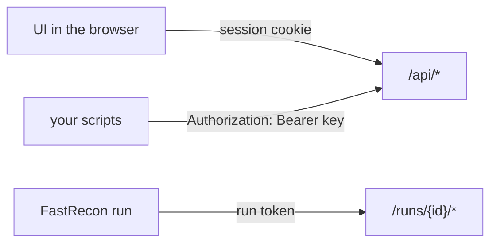

## Authentication

| Caller | Credential | Reaches |
|---|---|---|
| UI | `POST /api/session` with the API key sets an httpOnly, `Secure`, `SameSite=Strict` signed cookie (30 days) | `/api/*` |
| Scripts | `Authorization: Bearer <api key>` | `/api/*` |
| A FastRecon job | the run's [HMAC tokens](/architecture/stack/#the-scaleway-runner), in a header | its own `/runs/{id}/targets` and `/runs/{id}/report` |

The API key is set in the config. A write with the cookie must also carry an `Origin` matching
`public_url`, which with `SameSite=Strict` covers CSRF.

## Routes

| Route | Does |
|---|---|
| `POST /api/session`, `DELETE /api/session` | log in, log out |
| `GET /api/search?q=&view=services\|hosts&cursor=` | search results |
| `GET /api/search/facets?q=` | facet counts for a query |
| `GET /api/search/fields` | the fields, types and operators the language accepts |
| `GET /api/search/export?q=&format=csv\|json\|urls\|hosts` | export a result |
| `GET /api/assets/{id}` | one asset: current state, technologies, pivots, lineage |
| `GET /api/assets/{id}/changes` | its timeline |
| `GET /api/assets/{id}/screenshots` | its screenshots, with their URLs |
| `GET /api/screenshots/{key}` | one screenshot or thumbnail, only for a key a row names, as `image/jpeg` with `nosniff` |
| `POST /api/assets/{id}/render`, `POST /api/assets/{id}/probe` | render now (high priority), probe now (its host goes first in line for `full`) |
| `PATCH /api/assets/{id}/triage` | triage state, tags, note, mark as seen |
| `GET /api/changes?q=&view=unseen\|all&run=&cursor=` | the changes feed, newest first |
| `GET /api/changes/unseen` | how many changes are unseen, for the navigation |
| `POST /api/changes/seen` | mark as seen what a feed query shows (`q`, `run`) |
| `GET /api/notifications` | the last notifications, sent or not, and the channels set |
| `GET /api/programs`, `POST /api/programs` | list, create a manual program |
| `GET /api/programs/{id}`, `PATCH /api/programs/{id}` | one program, edit state or auto-scan |
| `POST /api/programs/{id}/rules` | open a local rule |
| `PATCH /api/programs/{id}/rules/{rule}` | close or edit a rule |
| `POST /api/programs/{id}/assets` | enter hosts and URLs |
| `POST /api/programs/{id}/imports/bbot` | import a BBOT `output.json` |
| `POST /api/sync` | run a ScopesExtractor sync now |
| `GET /api/wildcards?sort=oldest` | recon coverage |
| `POST /api/wildcards/{id}/recon` | queue a recon on one wildcard |
| `POST /api/wildcards/recon` | queue a recon on the N oldest, optionally per program |
| `GET /api/runs`, `GET /api/runs/{id}` | runs, with per source accounting |
| `GET`, `POST`, `PATCH`, `DELETE /api/saved-searches` | saved searches |
| `GET /api/health` | sync, CT, Fingerprinter, runners, render queue (public, states only) |
| `GET /api/settings` | the config in effect without its secrets, and screenshot storage used |
| `GET /*` (anything else) | the interface, `index.html` for any path it routes itself |
| `GET /runs/{id}/targets` | one host per line, for that run only, while it runs |
| `POST /runs/{id}/report` | the FastRecon report, once: `409` when the run is no longer running |

There is no `DELETE` on programs, rules or assets ([P2](/architecture/principles/#p2-nothing-is-deleted)).
Saved searches are your settings, not inventory, so they can be deleted.

## Answers

| Case | Answer |
|---|---|
| unknown search field, bad operator for a type | `400`, `{"error": "unknown_field", "detail": "…", "suggest": "tech"}` |
| missing or wrong credential | `401` |
| unknown id | `404` |
| a report for a run already finished or timed out | `409`, the report is not ingested |
| render or recon asked on an asset or wildcard out of scope | `200` with `queued: false` and a reason |

Lists are paginated with an opaque cursor ordered on a stable key, never with an offset.
