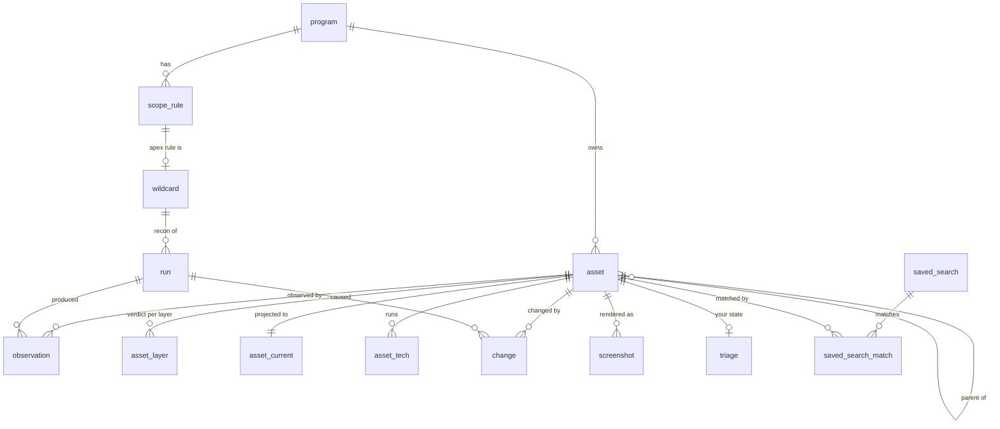
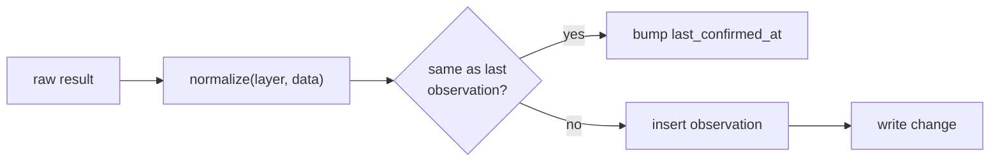

## Four layers of data

| Layer | Nature | Mutability |
|---|---|---|
| **Asset** | the stable identity of a host, an address, a service or a declared URL | never deleted |
| **Observation** | what one scanner saw on one layer, over a time span | append only |
| **Current state** | the last observation per layer, flattened for search | rewritten |
| **Change** | one recorded event on an asset: a new asset, an observation that differs, a lifecycle or scope move | append only |

Search reads the current state. The timeline and the changes feed read changes.

## Tables



The CT feed keeps `ct_session` (one row per connected period, with what it saw), `ct_apex` (what it
brought per watched wildcard, see [coverage](/architecture/discovery/#coverage-per-apex)), and `asset_current.ct_lane`
marks a host a certificate brought until it is measured or archived.

Notifications keep their own state, outside the inventory: `notification` (one message per window,
its items, when it is due and when it was sent) and `health_state` (per component, since when it fails
and whether that was announced).

| Table | Holds |
|---|---|
| `program` | origin (`scopesextractor` or `manual`), platform and slug, state, auto-scan override |
| `scope_rule` | include or exclude, matcher, pattern, `origin` (`sync` or `local`), `valid_from`, `valid_to` |
| `wildcard` | one per apex rule: `last_recon_at`, `last_recon_run`, `assets_found` |
| `asset` | program, kind, canonical key, parent, lineage, scope status, first and last seen |
| `observation` | asset, layer, outcome, data, `observed_at`, `last_confirmed_at`, run, `producer_version`. Partitioned by month |
| `asset_layer` | per asset and layer: state, informative and non informative failure counters, `first_failure_at`, `last_ok_at` |
| `asset_current` | everything search filters on, see below |
| `asset_tech` | one row per technology: name, category, raw version, parsed version, proof |
| `change` | see [changes](#changes) |
| `screenshot` | asset, storage key, thumbnail key, perceptual hash, taken at |
| `run` | kind, stage, wildcard or target list, state, deadline, timings, counters |
| `triage` | your state on an asset: `new`, `seen`, `interesting`, `ignored`, tags, note, `seen_at` |
| `saved_search` | name, query, view (services or hosts), whether it alerts, when its matches were last evaluated |
| `saved_search_match` | which assets a search currently matches, and since when |

## Asset kinds and canonical keys

The unique key is `(program_id, kind, key)`. The same name in two programs is two assets, each judged
by its own scope.

| Kind | Key | Example | Created by |
|---|---|---|---|
| `fqdn` | lowercase, no trailing dot, punycode | `api.target.com` | recon, CT, import, manual, scope rule |
| `ip` | compressed, IPv4-mapped reduced | `2606:4700::1` | a resolution answer |
| `service` | `host:port/proto` | `api.target.com:8443/tcp` | an open port on a host |
| `url` | scheme, host, port if non standard, path. No query | `https://target.com/app` | **declared only** |

**No scan creates a `url` asset.** A path is where a redirect landed that day. It stays in the
observation, and the asset is the service. A URL is an asset only when you or a scope rule names it.

### Which kind carries which layer

| Kind | Layers | Observed by |
|---|---|---|
| `fqdn` | `dns`, `tcp` | its own verification run |
| `ip` | none of its own | the hosts that resolve to it: `last_seen` moves while one does |
| `service` | `http`, `fingerprint` | its host's run (HTTP probe), and its renders |
| `url` | `http`, `fingerprint` | its service's run, and its own renders |

## Observations are deduplicated on write

Two producers write observations: FastRecon (`dns`, `tcp`, `http`) and the Fingerprinter
(`fingerprint`). Nothing else does: CT, imports and manual entries only declare assets.



A row means "this state held from `observed_at` to `last_confirmed_at`". Most probes confirm the
previous state, so the volume drops by an order of magnitude without losing history. The producer
version is stored next to the data and not compared, so a scanner upgrade alone writes nothing.

Normalization happens in one function, before every write: sort arrays whose order means nothing,
lowercase case-insensitive values, drop fields that change on every request.

| Layer | Producer | Dropped before comparing |
|---|---|---|
| `dns` | FastRecon | nothing volatile arrives |
| `tcp` | FastRecon | the scanned port list (counts are kept) |
| `http` | FastRecon | response time, content length |
| `fingerprint` | Fingerprinter | cookie values, hop sizes and IPs, `network`, request ids, dates, CSP nonces, the screenshot |

## Changes

| Column | Meaning |
|---|---|
| `asset_id`, `program_id` | where |
| `kind` | see the [list of kinds](/architecture/notifications/#changes) |
| `layer` | for observation changes, `NULL` otherwise |
| `before`, `after` | the values that moved, as JSON |
| `run_id` | the run whose report caused it, `NULL` for CT, sync, imports or your actions |
| `at` | when |

A change is written in the same transaction as what caused it. Whether you have seen it is read from
`triage`: a change is unseen when it is newer than the asset's `seen_at`.

## Current state

`asset_current` is one row per asset with typed columns for everything the
[search language](/architecture/search/) filters on:

| Group | Columns |
|---|---|
| identity | program, kind, key, host, apex, port, scheme, scope status |
| lifecycle | lifecycle, `dns_state`, `tcp_state`, `http_state`, `fingerprint_streak` |
| scheduling | `next_resolve_at`, `next_full_at`, `next_render_at`, `render_priority`, `render_failures`, `backoff_tier` |
| network | IPs, ASN, AS organization, country, CDN. On a service, copied from its host at ingestion. ASN and country come from local GeoLite2 files, read from the first address |
| HTTP (FastRecon) | status code, title, server, final URL |
| render (Fingerprinter) | redirect hosts, header names, cookie names, script hashes, favicon hash, external hosts, web sockets, metadata flags, WAF |
| dates | `first_seen`, `last_seen`, `last_changed`, `last_render_at` |
| triage | triage state, tags, copied from `triage` |

Technologies live in `asset_tech` rather than in an array, because a version filter has to bind a
version to **its** technology:

| asset | name | version_raw | version |
|---|---|---|---|
| svc 42 | nginx | `1.24.0` | `{1,24,0}` |
| svc 42 | PHP | `8.1.2-1ubuntu2` | `{8,1,2}` |
| svc 42 | jQuery | | `NULL` |

The parsed version is an integer array, which PostgreSQL compares element by element. See
[versions](/architecture/search/#technologies-and-versions).

## Lineage

`asset.discovery_source` says how an asset first appeared (`fastrecon`, `certstream`, `bbot`,
`scopesextractor`, `manual`) and `discovery_path` lists the steps, so "why is this here" always has an
answer.

```json
[
  {"step": "enumerated", "run": "01M0GH", "wildcard": "*.target.com", "sources": ["crt", "chaos"]},
  {"step": "resolved", "addresses": ["93.184.216.34"]},
  {"step": "port_open", "port": 8080}
]
```

## Retention

Nothing is purged in the first version: assets, observations and changes are kept. Observations and
changes are partitioned by month so that a purge, if one is ever needed, is a `DROP TABLE`.
Screenshots are the exception, bounded per service ([fingerprinting](/architecture/fingerprinting/#screenshots)).
