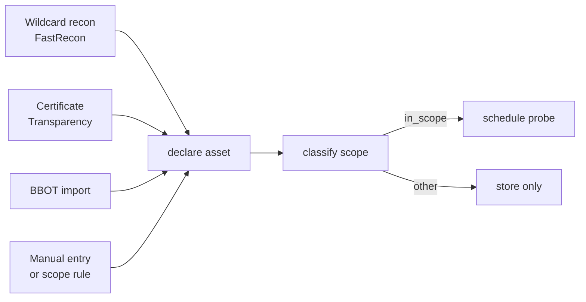
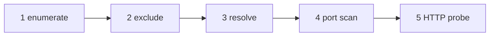
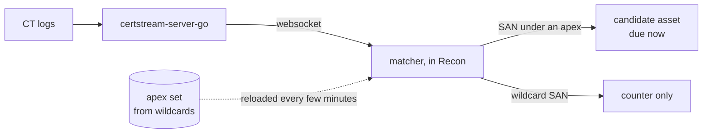
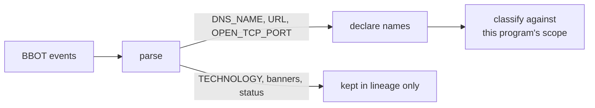

## Four entry points, one path



| Entry | Writes observations | Then |
|---|---|---|
| Wildcard recon | yes, it measured | resolving names are `active`, the rest are candidates |
| Certificate Transparency | no | candidate, `resolve` immediately |
| BBOT import | no | candidate, `resolve` jittered |
| Manual entry, scope rule | no | candidate, `full` immediately for a manual host |

Only the scanners write observations. A certificate proves a name was issued, a BBOT file proves a tool
saw something at some point: Recon re-measures both before believing them. The exact first due dates are
in [lifecycle](/architecture/lifecycle/#first-due-dates).

## Wildcard recon

A FastRecon run with the apex as `--domain` and the program's exclusions as `--exclude`, on the `full`
stage: enumerate, resolve, port scan, HTTP probe.

**It never runs on a timer.** It starts when:

- you start it, on one wildcard or on the N oldest ([interface](/architecture/interface/#wildcards));
- a new wildcard appears and [auto-scan](/architecture/programs/#auto-scan) is `on_new`.



One run per apex: FastRecon takes a single `--domain`.

What the report gives Recon:

- **every source with its status**, so a source that returned nothing is visible rather than read as
  an empty perimeter;
- **names that do not resolve**, with a reason (`nxdomain`, `no_answer`). They are kept as candidates:
  an enumeration cannot conclude a death ([P1](/architecture/principles/#p1-absence-of-proof-is-not-proof-of-absence)),
  and a name that comes alive later is exactly what the candidate curve catches;
- **hosts it did not reach**, marked `discovered`, kept as candidates with no observation, so a
  truncated run states its gap.
- **wildcard hosts**, kept as candidates with their `dns` observation: they resolve, but only to the
  zone's wildcard, so nothing proves they exist.

Its `tech` field is ignored: technologies come from the Fingerprinter only. Its `tls` block (subject,
issuer, SANs, SPKI hash) is kept in the service's `http` observation.

A recon never moves an asset toward death and never downgrades a lifecycle: it only creates assets and
promotes candidates that now resolve ([P1](/architecture/principles/#p1-absence-of-proof-is-not-proof-of-absence)).

The run updates `wildcard.last_recon_at`. A failed run does not.

### The port list

Configuration, sent with every run, so recon and verification scan the same ports. A port earns its
place if it can carry a finding.

| Family | Ports |
|---|---|
| Web | 80, 443, 8080, 8443, 8000, 8090, 9000, 9443, 3000, 5000 |
| Admin and orchestration | 2375, 2376, 6443, 10250, 15672, 5601, 8983, 9990, 2083, 2087 |
| Databases and stores | 3306, 5432, 27017, 6379, 9200, 11211, 9042, 2379 |
| Remote access and proxies | 3389, 5900, 1080, 3128 |

### Source keys

FastRecon's API keys live in the runner's environment, never in the run definition or the database.
A keyed source without a key reports `skipped_no_key`, and the run page shows it.

## Certificate Transparency

A staging host gets a certificate before it gets traffic. Watching the CT stream sees its name the
same minute.



### Matching walks labels

```
staging.api.target.com  →  api.target.com  →  target.com ✓
```

At most a few lookups per SAN, whatever the number of programs. Climbing **label boundaries** rather than
testing a string suffix is what stops `target.com.evil.com` from matching. The walk collects every
matching apex, so one name under two programs creates two assets.

### What it creates

| SAN | Result |
|---|---|
| a name under an active program's wildcard | an `fqdn` candidate, lineage = issuer and log |
| a name already in the inventory | nothing, the unique key absorbs it |
| an archived name | revived as a candidate: a new certificate is the strongest sign it is coming back |
| `*.target.com` | nothing, counted on the wildcard |

### Guardrails

| Risk | Guard |
|---|---|
| a broad apex floods the inventory | a per program ceiling per hour, and the overflow is counted, not hidden |
| a burst of reissued certificates | an in-memory cache on `(program, SAN)`. Correctness rests on the unique key, never the cache |
| the websocket drops | connected periods are recorded, so a gap reads as a gap |

A gap is not backfilled. It is covered by wildcard recon, and the [wildcards view](/architecture/interface/#wildcards)
shows which ones have not been scanned for a long time.

## BBOT import

`POST /api/programs/{id}/imports/bbot` (or `recon import bbot <program> <file>`) takes the `output.json` event stream of a BBOT scan.



- **An import declares, it does not observe.** The scan ran elsewhere, at a date Recon did not choose, so
  nothing it saw enters the observation journal. Technologies come from the Fingerprinter only.
- **Its scope is not ours.** Every name is classified against the program's rules, whatever BBOT thought.
- **A claim earns the cheap rung.** New names are candidates due for `resolve`. If a name is dead, it
  follows the candidate backoff and is archived when the budget runs out, without ever being called
  dead.
- **It does not revive archived assets.** A file is not evidence that something came back.

The response reports per name what happened: created, already known, out of scope, refused.

## Manual entry

`POST /api/programs/{id}/assets` takes hosts and URLs. A host is due for `full` right away, because you
typed it in to see what it exposes. A URL declares its service and host, and is rendered as written once
the service answers.
