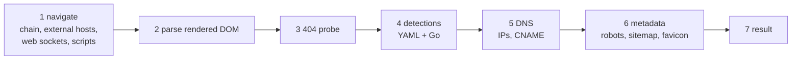
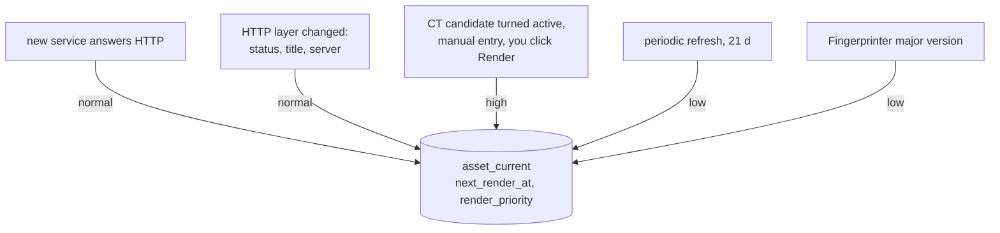
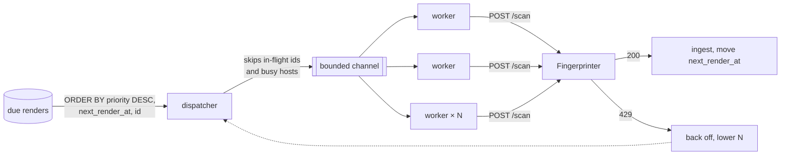
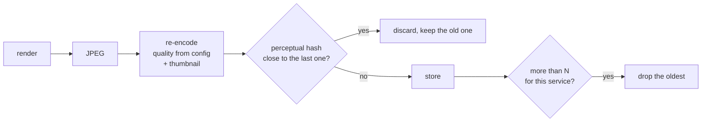

FastRecon is the **detector**: is it alive, did it move, as cheaply as possible. The Fingerprinter is the
**enricher**: a real browser, expensive, and the only source of technologies.

## The service

A long-running HTTP service: a pool of headless Chrome instances over CDP, round-robin, on an isolated
network with no route to Recon's database.



### Request

```
POST /scan
{ "url": "https://app.target.com/", "options": { "screenshot": true } }
```

| Option | Default | Note |
|---|---|---|
| `timeout_seconds` | server `scan_timeout` (90 s) | can only tighten the server limit, a higher value is a `400` |
| `max_redirects` | server setting (10) | same |
| `skip_path_checks` | `false` | Recon never sets it: dropping the 404 probe and metadata on some renders would read as a change on the next one |
| `screenshot` | `false` | Recon always asks, the [perceptual hash](#screenshots) decides what is kept |

### Response

| Field | Contents | In Recon |
|---|---|---|
| `url` | the requested URL | |
| `chain[]` | per hop: `url`, `status_code`, `headers`, `title`, `response_size`, `remote_ip_address` | `redirect:`, `header:` filters. Sizes and IPs dropped at normalization. Status and title stay in the observation: the `status:` and `title:` filters read FastRecon's |
| `technologies[]` | `name`, `version`, `category`, `cpe`, `proof` | `asset_tech`, `tech:` and `category:` filters |
| `cookies` | name to value | names only, `cookie:` pivot |
| `scripts[]` | `url`, `internal`, `hash` (SHA-256) | `script:` pivot |
| `external_hosts[]` | third party hosts contacted during the render | `external:` filter |
| `web_sockets[]` | WebSocket URLs the page opened | `websocket:` filter |
| `metadata` | `robots_txt`, `llms_txt`, `sitemap`, `favicon` (data URI), `favicon_url`, `favicon_hash` (mmh3) | `has:robots`, `has:llms_txt`, `favicon:` pivot |
| `network` | `host`, `ips`, `cname` | dropped: DNS belongs to FastRecon ([P4](/architecture/principles/#p4-one-producer-per-value)) |
| `screenshot` | base64 JPEG of the viewport | [screenshots](#screenshots) |
| `scanned_at`, `version` | when, and which build | `version` goes to `observation.producer_version`, never compared, so a bump alone writes no change |

`proof` names the evidence per check (`headers`, `cookies`, `body`, `meta`, `js`, `favicon`, `probe`,
`dns`, `extension`, `xhr`). It is shown on the asset view so a detection can be trusted or not at a
glance.

CDN and WAF products are technologies of category `CDN` and `WAF`, which is what the `waf:` filter reads.
The `cdn:` filter reads FastRecon's per address determination, available on every host, rendered or not.

| Other endpoint | Use |
|---|---|
| `GET /health` | status and version, polled by Recon's health check |
| `GET /detections` | the loaded detections, feeds autocomplete for `tech:` and `category:` |

## When a render is due



A trigger never adds a row. It sets `next_render_at = min(current, now)` and `render_priority = max(current,
new)`, so a service hit by three triggers is rendered once.

A first contact is rendered **whatever the status code**: a 403 or a challenge to FastRecon often renders
fine in a browser. The target is the service root, except for a declared URL, rendered as written.

## Absorbing a burst

A recon on a large wildcard can bring a thousand new services in one report, all due at the same second.
The queue has to drain them at the pace the Fingerprinter sustains, without starving what is urgent and
without hammering one target.



| Mechanism | Rule |
|---|---|
| **The due date is the queue** | nothing moves `next_render_at` except ingesting a result. A refused, failed or interrupted render stays due, and a restart loses nothing |
| **Priority first, then age** | high (you, CT) jumps the burst, the burst (normal) passes before periodic refreshes (low). Within a level, oldest first |
| **Adaptive concurrency** | N starts at `render.concurrency` (below the Fingerprinter's `concurrent_scans`). A `429` halves it, every 20 successes add one back, up to the max |
| **Honour `Retry-After`** | on a `429` the dispatcher pauses for `Retry-After × random(0.5, 1.5)`, so refused workers do not come back as a convoy |
| **Per host politeness** | at most 2 renders in flight per host and 4 per apex. A thousand vhosts on one origin are spread over time instead of hitting it together |
| **In-flight set in memory** | one process, so a map of in-flight ids is enough. No lease, no lock table |
| **Fingerprinter down** | connection refused or `/health` failing pauses the dispatcher and raises one health notification. Renders stay due |

### What a burst costs

A render takes 10 to 30 seconds. With 20 workers that is roughly one render a second:

| Burst | Drain time at ~1 render/s |
|---|---|
| 100 services | ~2 min |
| 1 000 services | ~15 to 25 min |
| 10 000 services | ~3 to 5 h |

The runs page shows queue depth per priority, the current rate and an estimated drain time. A deep
queue is not an incident, so it does not notify.

### Render outcomes

| Fingerprinter answer | Observation | Due date |
|---|---|---|
| `200`, result | written, normalized and deduplicated | moved to the next cadence |
| `200`, target unreachable in the browser | written, `outcome = error`. Counts as a failed observer toward `unobservable`, never toward `inactive` | moved to the next cadence |
| `429` | **nothing**: the service was busy, the asset did nothing | unchanged |
| timeout, `5xx`, connection refused | nothing | unchanged, dispatcher backs off |

A `429` must never touch the asset: counting it would walk healthy assets toward `unobservable` because
the renderer was busy.

## Technologies

Technologies come **only** from the Fingerprinter. Each one becomes a row of `asset_tech` with its raw
and parsed version, which is what makes [version filters](/architecture/search/#technologies-and-versions)
possible.

| Raw | Parsed | Note |
|---|---|---|
| `1.24.0` | `{1,24,0}` | |
| `v2.4` | `{2,4}` | leading `v` dropped |
| `8.1.2-1ubuntu2` | `{8,1,2}` | suffix kept in the raw value only |
| `1.24` | `{1,24}` | not padded to `1.24.0` |
| `latest`, empty | `NULL` | matches only `@?` (unknown version) |

A version going from `1.24` to `1.24.0` is a gain in precision, not an application change: recorded,
never notified.

## Screenshots

The Fingerprinter returns a **JPEG of the viewport**. Only services that answer HTTP are screenshotted,
which keeps the count at tens of thousands rather than the hundreds of thousands of inventory entries.



### Sizing

Assuming ~80 KB per stored screenshot plus a ~10 KB thumbnail, and N = 3 distinct per service:

| Inventory | Latest only | Up to 3 distinct per service |
|---|---|---|
| 50 000 services | ~4.5 GB | ~7 to 13 GB |
| 200 000 services | ~18 GB | ~30 to 55 GB |

Storing every render would cost hundreds of GB a year at that size, which is why the perceptual hash
decides. The figures are estimates, to be measured on real renders in the phase that stores them.

### Storage

One interface, two backends, chosen in config:

| Backend | When |
|---|---|
| local directory | default, on the VPS disk |
| S3 compatible (Scaleway Object Storage, MinIO) | when the disk gets tight |

The UI shows the space used, and a health notification fires past a disk threshold. Keys are
content-addressed (`sha256.jpg`), so moving backends is a copy.
