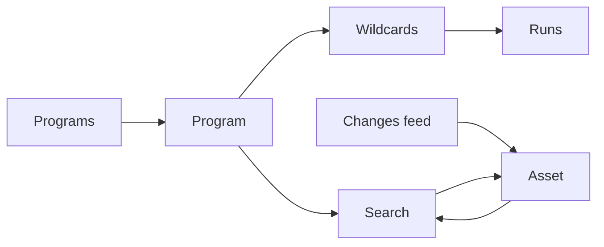

A static single page app, served by the Recon binary. Access is one API key, entered once and kept in
an httpOnly cookie ([API](/architecture/api/#authentication)).



## Screens

| Screen | For |
|---|---|
| **Search** | the main screen: query box, facets, results with screenshots, saved searches |
| **Asset** | everything about one asset, and its history |
| **Changes** | the feed of what moved, unseen first |
| **Programs** | the list, origin, state, counts, sync status |
| **Program** | scope rules, local rules, wildcards, untracked scopes, settings |
| **Wildcards** | recon coverage across every program |
| **Runs** | running and past runs, per source accounting, errors |
| **Settings** | saved searches, config in effect (read-only), storage usage, health |

## Activity

The status in the navigation opens a panel of what is happening now, refreshed every few seconds while
open. It answers "is my scan running, and where" without leaving the page.

| Block | Shows |
|---|---|
| Runs | running and queued runs: kind, wildcard or host count, runner (`serve` or `scaleway`), since when |
| Renders | the queue per priority, renders in flight against the current concurrency |
| CT feed | connected or not, what the session saw: certificates, names matched, created |
| Scope sync | last success, the last error while it fails |
| Problems | each failing component, since when and why, as the health watcher keeps it |

It is read from `GET /api/activity`, behind the session like the rest of the API: `/api/health` stays
public and says states only.

## Search

```
┌─────────────────────────────────────────────────────────────────────┐
│ tech:nginx@<1.25 status:2xx -cdn:*                  [Save] [Export] │
├──────────────┬──────────────────────────────────────────────────────┤
│ Technologies │ ┌──────┐ app.acme.com:443   200  "Dashboard"        │
│  nginx   412 │ │ shot │ nginx 1.22.1 · PHP 8.1 · jQuery 3.5         │
│  PHP     201 │ └──────┘ acme · first seen 3d · new                  │
│ Status       │ ┌──────┐ dev.foo.io:8443    200  "Grafana"          │
│  2xx     389 │ │ shot │ nginx 1.18.0 · Grafana 9.1                  │
│ Ports        │ └──────┘ foo · first seen 40d · seen                 │
│  443     300 │                                                      │
└──────────────┴──────────────────────────────────────────────────────┘
```

Results can be shown as a list or as a **screenshot grid**, the fastest way to scan a large result by eye.

## Asset

| Block | Contents |
|---|---|
| Header | key, program, scope, lifecycle, triage state, tags, notes |
| Screenshot | latest, with older distinct ones |
| Current state | DNS, ports, HTTP, redirect chain, technologies with versions, headers, cookies |
| Pivots | favicon, scripts, cookies, each with how many other assets share it |
| Timeline | changes over time, newest first |
| Lineage | why it is here |
| Actions | render now, probe now, triage |

## Triage

Each asset carries your own state, independent of its lifecycle.

| State | Meaning |
|---|---|
| `new` | never opened |
| `seen` | opened |
| `interesting` | worth coming back to |
| `ignored` | hidden from default views |

Plus free tags and a note. All of it is searchable (`triage:interesting tag:idor`).

## Wildcards

The answer to "what have I not scanned in a while".

| Wildcard | Program | Last recon | Assets | Auto-scan |
|---|---|---|---|---|
| `*.example.com` | Example | never | — | off |
| `*.foo.com` | Foo | 94 days ago | 1 204 | on_new |
| `*.acme.com` | Acme | 3 days ago | 3 310 | on_new |

Auto-scan shows the value in effect, from the program or the global default. A CT column shows what the
feed brought under the apex: names, or only wildcard certificates, or nothing since it is watched. Sorted oldest first, never
scanned on top. Actions: **scan this one**, **scan the N oldest**, filter by
program or platform.

## Copy

Interface in English, sentence case, no em dashes.
