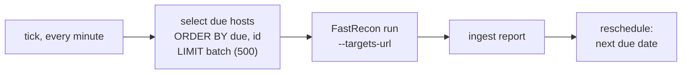
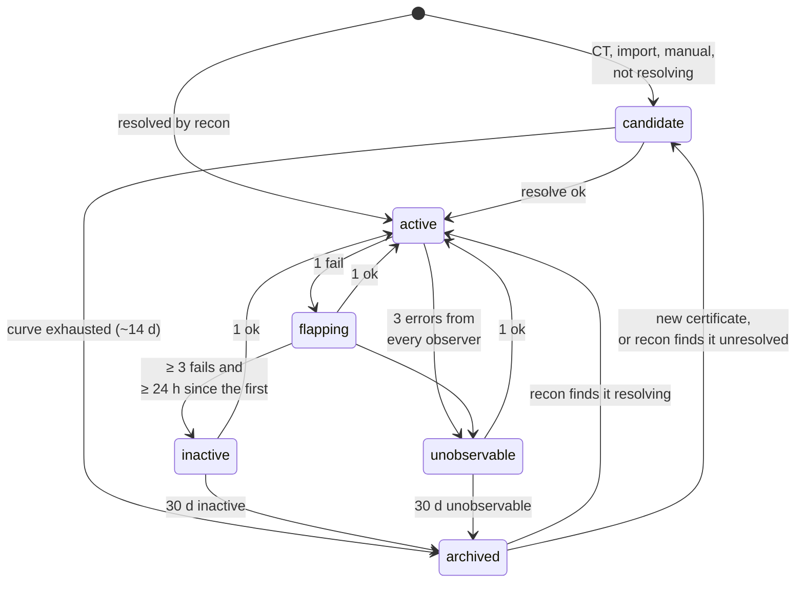
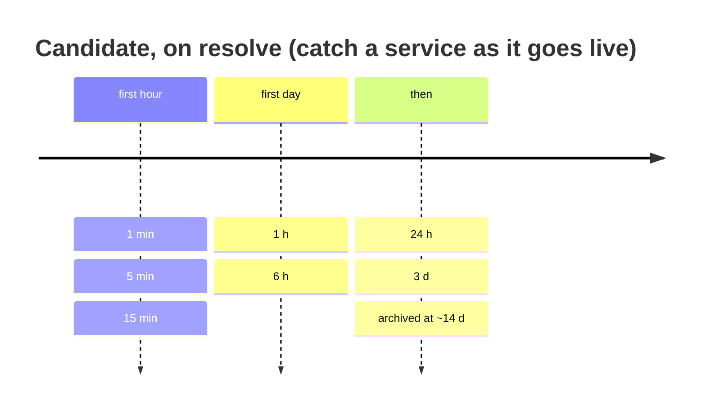
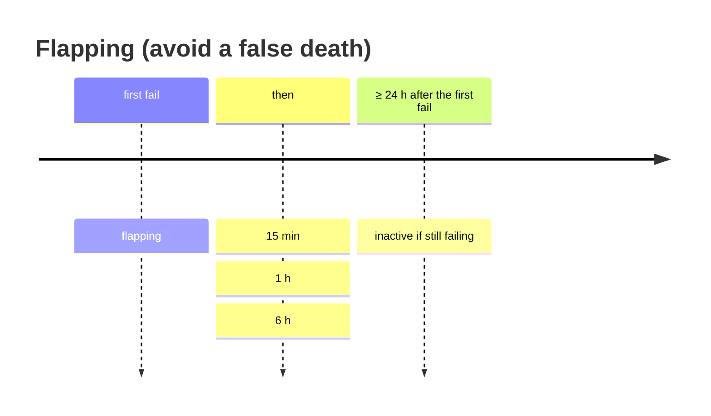

## Verification is periodic, discovery is not

Verification asks one question of the inventory: **what still answers?** It is a FastRecon run over an
explicit list of hosts, the only shape where a missing answer means something
([P1](/architecture/principles/#p1-absence-of-proof-is-not-proof-of-absence)).



Verification has no queue of its own: the due dates on `asset_current` **are** the queue. A run that
dies moves nothing, so once it [times out](/architecture/stack/#run-states) the next tick picks the
same hosts again.

### The stage ladder

| Due date | FastRecon stage | Default cadence | Cost |
|---|---|---|---|
| `next_resolve_at` | `resolve` | 24 h | one DNS round trip, nothing sent to the target |
| `next_full_at` | `full` | 72 h | port sweep plus HTTP probe |
| `next_render_at` | Fingerprinter | 21 d | a browser render, see [fingerprinting](/architecture/fingerprinting/) |

`full` runs every stage below it, so a host due for both gets one `full`. Targets are always `fqdn`
assets: services are measured through their host's `full` run, addresses through the hosts resolving to
them. Only `in_scope` assets of active programs get due dates. Every delay is jittered so a large batch
does not come back as a convoy.

### First due dates

| Source | Lifecycle | First probe |
|---|---|---|
| recon, name resolves | `active` | `full` within 15 min (jittered), the recon already measured it |
| recon, name found but not resolving, or not reached | `candidate` | `resolve`, candidate curve |
| Certificate Transparency | `candidate` | `resolve`, immediately |
| BBOT import, scope rule | `candidate` | `resolve`, jittered |
| manual entry | `candidate` | `full`, immediately |
| new service from an open port | `candidate` | its host's next `full`, render when it answers HTTP |

A candidate is probed on `resolve` along its curve. Its first successful resolution makes it `active` and
schedules a `full` within 5 minutes (jittered), which is what finds its ports and services.

## Qualifying a failure

FastRecon reports what it saw, and ingestion decides what it means from the data, never from a label
the scanner set.

| Signal | `outcome` | Informative |
|---|---|---|
| answered, present | `ok` | |
| `nxdomain` from FastRecon's validated resolver pool | `fail` | **yes** |
| every port refused on the host | `fail` | **yes**, on `tcp` |
| a known service's port refused in its host's sweep | `fail` | **yes**, on the service's `http` |
| a [dead-origin signature](#dead-origin-signatures) behind a CDN | `fail` | **yes**, on `http` |
| timeout, filtered | `error` | no |
| `servfail` | `error` | no |
| 403, WAF challenge | `ok` | the target is alive |
| any result from a run that reported itself degraded | `error` | no |
| `nodata` (name exists, no address) | `ok` | a mail-only host is not dead |

An **informative failure** is a `fail`: the target answered with an absence. It is the only kind that
moves an asset toward `inactive`. A host the run never reached produces **no** observation at all.

### Observers

An observer is what can get a result on an asset. A host has one, FastRecon. A web service has two,
FastRecon's HTTP probe and the Fingerprinter. An asset is `unobservable` when **every** observer that
tried got only `error`, three times in a row.

### Dead-origin signatures

A CDN edge always answers, so the only death signal behind it is the page the edge serves when the
origin is gone. The signatures are a list in the config (status plus body or header pattern), for
example Cloudflare `521`, `522`, `523` and CloudFront's "could not be satisfied". An unknown error page
is `error`, never `fail`.

## State machine



| State | Meaning | Probed |
|---|---|---|
| `candidate` | known, never confirmed alive | candidate curve, on `resolve` |
| `active` | last probe succeeded | nominal cadence |
| `flapping` | failing, below the threshold | flapping curve |
| `inactive` | death confirmed | `resolve` weekly |
| `unobservable` | nothing gets through: neither alive nor dead | `resolve` weekly |
| `archived` | out of the scheduler, never deleted | no |

The fail that moves an asset to `flapping` is the first of the three. A candidate has exactly two exits:
failing to find a name that was never found is not news, so a failing candidate stays a candidate and is
archived without being called dead. A BBOT import never revives an archived asset. Every transition
writes a `lifecycle_changed` change. Durations are configuration.

### Death is per layer

`dns`, `tcp` and `http` each keep their own state and counters in `asset_layer`. The asset takes the
**worst** layer with an opinion: a dead `http` behind a live CDN edge makes the service `inactive` even
though DNS and TCP answer, which is the only death signal a fronted target gives.

The `fingerprint` layer never moves an asset toward `flapping` or `inactive`. It only counts as one of
the observers for `unobservable`.

## Backoff curves





| Rule | Why |
|---|---|
| a CT candidate's first probe has no jitter | the certificate is the event, minutes matter |
| promotion to `full` takes jitter | a certificate with fifty names would otherwise form a 72 h convoy |
| backoff on `full` has a floor (1 h) | a failing host always holds the earliest due date and would starve the rest |
| all values are configuration | [P6](/architecture/principles/#p6-configuration-is-data) |

## Where transitions happen

In the ingestion transaction that writes the observation, through one pure function:

```
next_lifecycle(state, observation, counters) -> (state, counters, changes)
```

The changes it returns are written in the same transaction. Sending notifications happens after, and
can lag.
