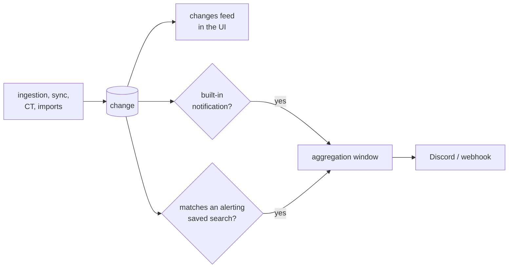
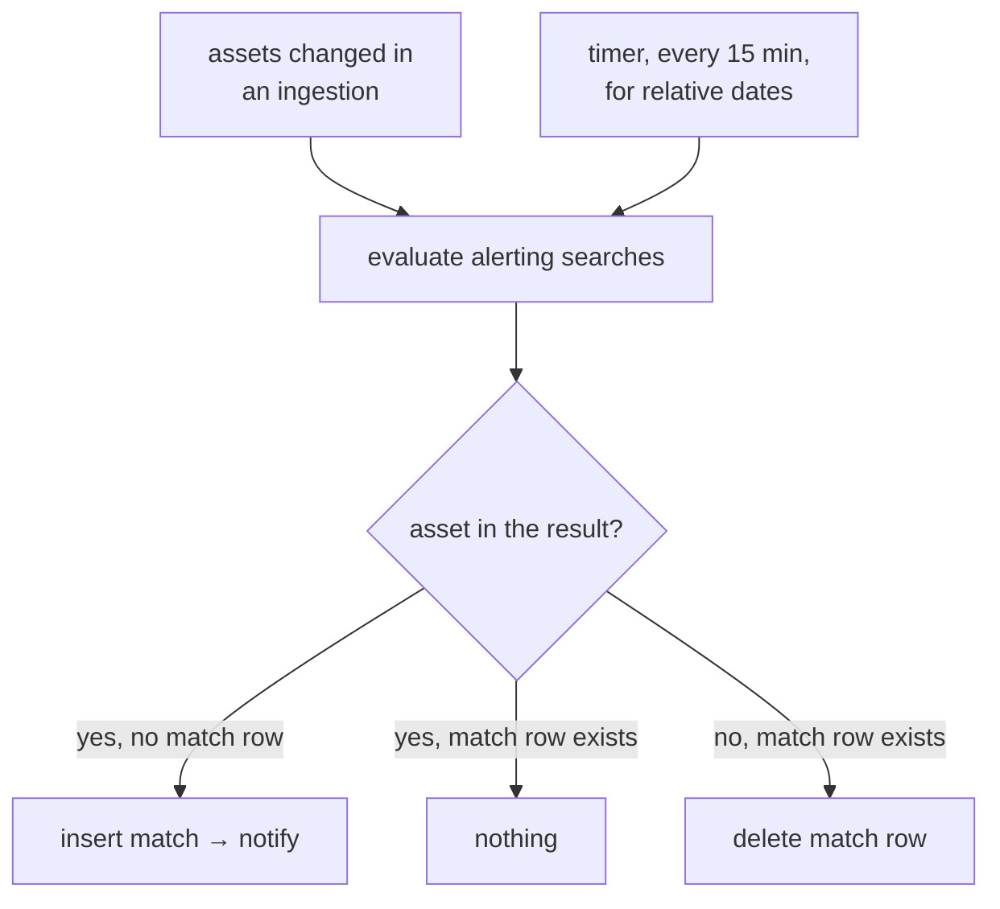

A notification is an interruption, and too many of them means none gets read. The rule: **every change
lands in the UI, very few leave it.**



## Changes

A `change` row is written in the same transaction as what caused it
([data model](/architecture/data-model/#changes)). Nothing is lost by notifying less.

| `kind` | Written when | Example |
|---|---|---|
| `new_asset` | an asset is created | a host appears under a wildcard |
| `lifecycle_changed` | any lifecycle transition | `candidate` → `active`, `flapping` → `inactive` |
| `scope_changed` | a rule moves the asset in or out | a scope removed on the platform |
| `dns_changed` | the `dns` observation differs: addresses, CNAME chain, status | a CNAME now points elsewhere |
| `port_opened`, `port_closed` | the host's `tcp` observation differs | 9200 opens on a known host |
| `http_changed` | the `http` observation differs: status, title, server, final URL | 403 becomes 200 |
| `tech_added`, `tech_removed`, `tech_version_changed` | the `fingerprint` observation differs on technologies | WordPress 6.1 becomes 6.4 |
| `render_changed` | the `fingerprint` observation differs on anything else: redirects, headers, scripts, favicon | the chain now lands on an SSO |

## What notifies, by default

| Notification | Why it earns one | Sent |
|---|---|---|
| **A name from a certificate now serves HTTP** | the freshness advantage: a service going live minutes after its certificate | 5 min after the first one, grouped per program |
| **A wildcard recon finished** | you started it, or auto-scan did | when the run ends, one message with counts |
| **An alerting saved search has new matches** | you asked for it | 15 min after the first new match, grouped per search |
| **Something is broken** | ScopesExtractor sync, CT feed, Fingerprinter or a runner failing for more than 5 minutes, disk past its threshold | once when it starts, once when it recovers |

The windows are trailing: the first event opens the window, and everything arriving before it closes
goes in the same message.

Everything else, a port opening, a technology change, an asset dying, waits in the feed. If one of
those matters, it becomes a saved search with an alert.

## Saved search alerts



Only an asset that **enters** the result set notifies. One that leaves loses its match row, so it
notifies again if it comes back. The timer pass catches queries whose result moves with time alone, such
as `first_seen:<24h`.

## Messages

One message per window, never one per asset:

```
[recon] *.acme.com finished: 1 204 hosts, 87 new, 23 new web services
        https://recon.example/changes?run=01M0GH

[recon] saved search "Old Jenkins": 2 new matches
        jenkins.acme.com:8080 (2.401), ci.foo.io:443 (2.387)
```

## Outputs

Channels are set in the config file, not in the UI.

| Channel | Config |
|---|---|
| Discord webhook | URL |
| Generic webhook | URL, optional header, JSON body |

## The changes feed

The feed lists changes, newest first, filterable with the same [search language](/architecture/search/)
plus `change:` (`change:port_opened,tech_version_changed`). A change is unseen while it is newer than
the asset's `seen_at`, and opening an asset marks everything on it as seen.
