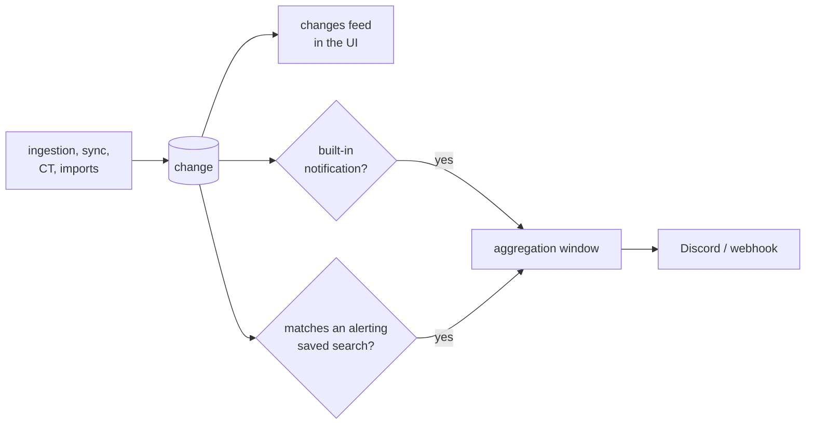
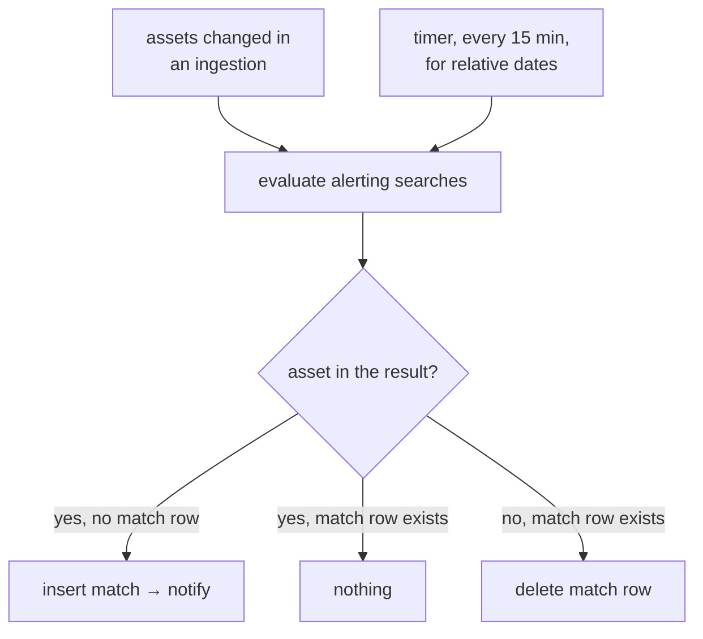
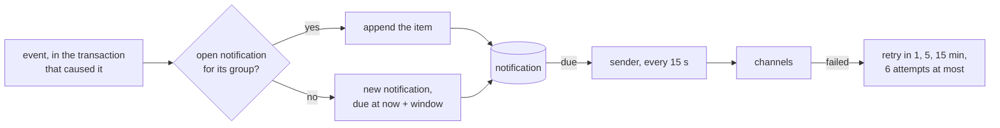

A notification is an interruption, and too many of them means none gets read. The rule: **every change
lands in the UI, very few leave it.**



## Changes

A `change` row is written in the same transaction as what caused it
([data model](/architecture/data-model/#changes)). Nothing is lost by notifying less.

| `kind` | Written when | Example |
|---|---|---|
| `new_asset` | an asset is created | a host appears under a wildcard |
| `lifecycle_changed` | any lifecycle transition | `candidate` → `active`, `flapping` → `inactive` |
| `scope_changed` | a rule moves the asset in or out | a scope removed on the platform |
| `dns_changed` | the `dns` observation differs: addresses, CNAME chain, status | a CNAME now points elsewhere |
| `port_opened`, `port_closed` | the host's `tcp` observation differs | 9200 opens on a known host |
| `http_changed` | the `http` observation differs: status, title, server, final URL | 403 becomes 200 |
| `tech_added`, `tech_removed`, `tech_version_changed` | the `fingerprint` observation differs on technologies | WordPress 6.1 becomes 6.4 |
| `render_changed` | the `fingerprint` observation differs on anything else: redirects, headers, scripts, favicon | the chain now lands on an SSO |

## What notifies, by default

| Notification | Why it earns one | Sent |
|---|---|---|
| **A name from a certificate now serves HTTP** | the freshness advantage: a service going live minutes after its certificate | 5 min after the first one, grouped per program |
| **A wildcard recon finished** | you started it, or auto-scan did | when the run ends, one message with counts, or with the error if it failed |
| **An alerting saved search has new matches** | you asked for it | 15 min after the first new match, grouped per search |
| **Something is broken** | ScopesExtractor sync, CT feed, Fingerprinter or FastRecon (`/healthz`) failing for more than 5 minutes, the screenshot disk past its threshold | once when it starts, once when it recovers |

The windows are trailing: the first event opens the window, and everything arriving before it closes
goes in the same message.

Everything else, a port opening, a technology change, an asset dying, waits in the feed. If one of
those matters, it becomes a saved search with an alert.

## Saved search alerts



Only an asset that **enters** the result set notifies. One that leaves loses its match row, so it
notifies again if it comes back. The timer pass catches queries whose result moves with time alone, such
as `first_seen:<24h`.

Switching an alert on records what the search already matches **without** notifying: the alert is about
what comes next, not about the inventory you already have. Editing its query or view does the same.

A search selecting more than 100 000 assets is not evaluated, and says so in the log: a sample would
differ from pass to pass and read as assets entering.

## Messages

One message per window, never one per asset:

```
[recon] *.acme.com finished: 1 204 hosts, 87 new, 23 new web services
        https://recon.example/changes?run=01M0GH

[recon] saved search "Old Jenkins": 2 new matches
        jenkins.acme.com:8080 (2.401), ci.foo.io:443 (2.387)
```

## Delivery



| Rule | Why |
|---|---|
| the notification row is written in the transaction of its event | a crash between the two neither loses nor invents one |
| a group is a program, a saved search, a run or a component | what the windows above group by |
| ten items per message, then `and N more` | one message per window, whatever its size |
| a retry goes to the channels that did not get it | one channel down must not make the others repeat |
| no channel configured: the row is kept and marked as such | the settings page lists the last notifications either way |
| Discord mentions are disabled | a page title from a target must not ping anyone |

## Outputs

Channels are set in the config file, not in the UI.

| Channel | Config | Body |
|---|---|---|
| Discord webhook | `notify.discord_url` | the message text |
| Generic webhook | `notify.webhook_url`, optional `notify.webhook_header` | JSON: `kind`, `title`, `items`, `more`, `link`, `text` |

## The changes feed

The feed lists changes, newest first, filterable with the same [search language](/architecture/search/)
plus `change:` (`change:port_opened,tech_version_changed`), which only the feed accepts. A change is
unseen while it is newer than the asset's `seen_at`, and opening an asset marks everything on it as seen.

| View | Shows |
|---|---|
| **Unseen** (the default) | the unseen changes of what the query matches; the navigation shows their count |
| **All** | every change of what the query matches |
| a run, `?run=` | the changes one run caused, the link a recon message carries |

**Mark as seen** sets `seen_at` on the assets behind the unseen changes the query shows, as opening each
of them would.
