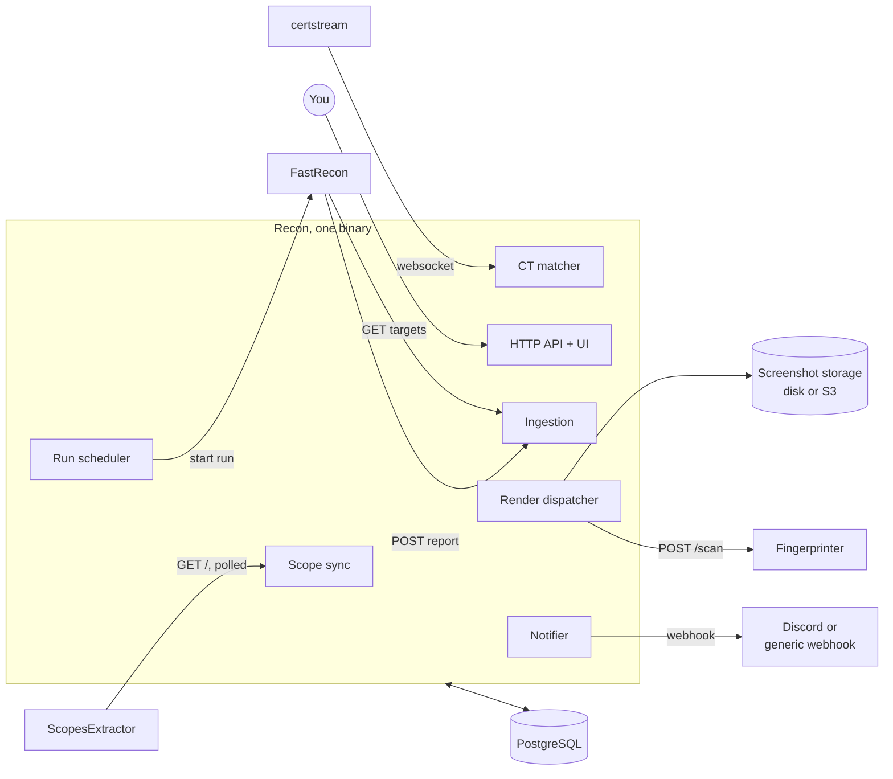
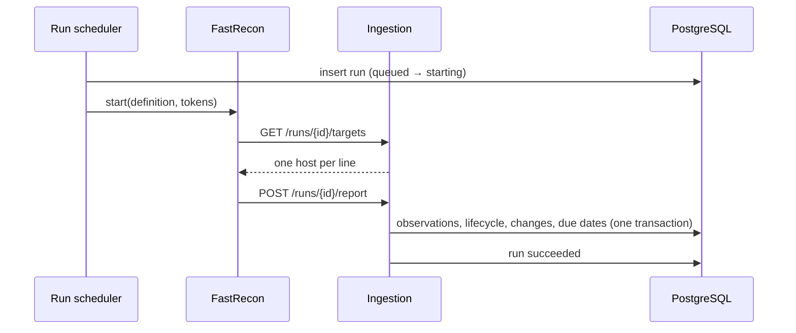

| Edge | Meaning |
|---|---|
| ScopesExtractor → scope sync | Recon pulls the scopes and reconciles its programs ([programs](/architecture/programs/)) |
| certstream → CT matcher | new names under a known wildcard become candidates ([discovery](/architecture/discovery/#certificate-transparency)) |
| Run scheduler → FastRecon | starts a run through a runner. FastRecon never touches the database |
| FastRecon → ingestion | fetches its target list, posts one report back |
| Render dispatcher → Fingerprinter | renders due services and ingests the result. The Fingerprinter holds no credential |
| Notifier → webhook | the only outbound alerts |

Loops inside the binary never call each other: they communicate through the database. A report
ingested makes services due for a render by writing their `next_render_at`, and the render dispatcher
picks them up on its next pass.

## One process

API, embedded UI, scope sync, CT matcher, run scheduler, ingestion, render dispatcher and notifier are
one binary. The scanners stay separate services because they already are, and because the
Fingerprinter runs attacker controlled JavaScript and must stay on its own network.

## A run, end to end

Run states and timeouts are in [stack](/architecture/stack/#run-states).
