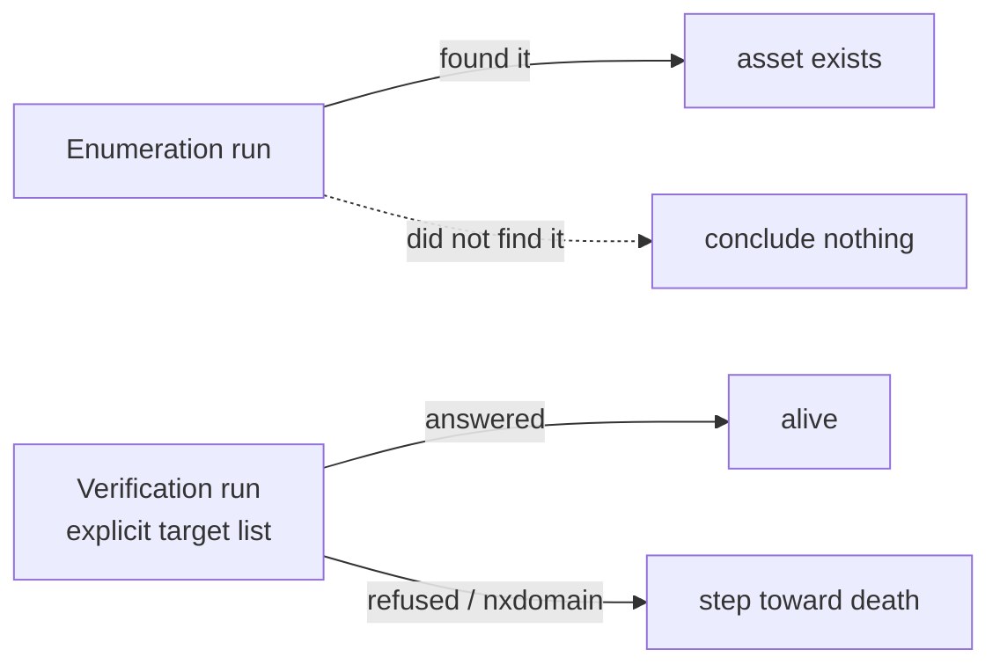

## P1: Absence of proof is not proof of absence

Comparing two enumeration runs never declares an asset dead. A source that rate-limited or a key
that expired makes a host vanish from a report while nothing changed on the target.

Only a run over an **explicit list of targets** can move an asset toward death, because only there
does a missing answer mean something.

## P2: Nothing is deleted

An asset ages, changes state and ends up archived. A scope rule is closed, not removed. A program
leaving a platform is archived. Out of scope today can be in scope in six months, and its history is
what makes that useful.

## P3: A failure is qualified before it counts

A timeout is not a death. A failure counts toward death only when something reached the target and
reported an absence (`nxdomain`, connection refused). Everything else makes the asset
**unobservable**, never dead. See [lifecycle](/architecture/lifecycle/#qualifying-a-failure).

## P4: One producer per value

Each value has exactly one source, so a change means the target changed, not that two tools disagree.

| Value | Producer |
|---|---|
| DNS, open ports, HTTP status, title, server, final URL, CDN | FastRecon |
| Technologies and versions, WAF, the browser's redirect chain, headers, cookies, scripts, favicon, web sockets, screenshot | Fingerprinter |
| ASN, AS organization, country | a local IP database, at ingestion |
| Scope of synced programs | ScopesExtractor |

## P5: Notify the essential, show the rest

A notification is an interruption. Only a handful of events earn one, and anything else is one click
away in the UI. See [notifications](/architecture/notifications/).

## P6: Configuration is data

Port lists, cadences and thresholds are values in a config file. No setting runs a command.
