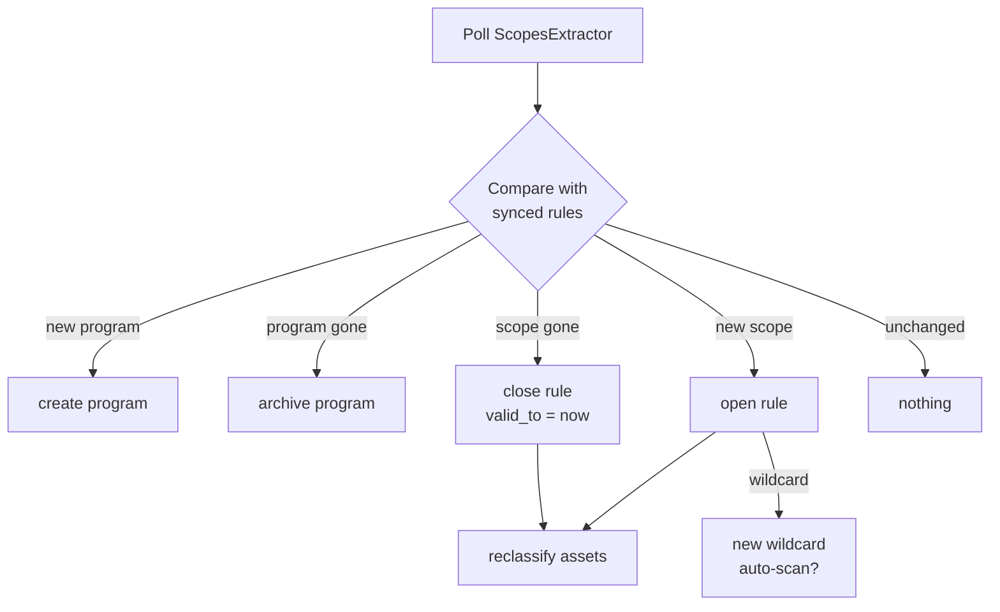
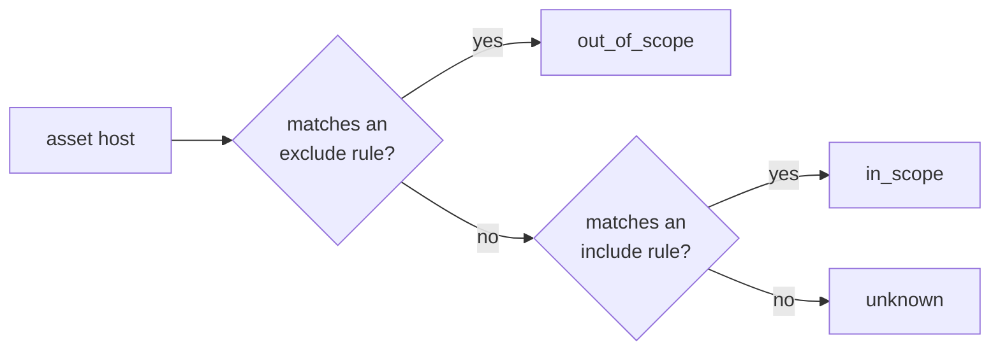
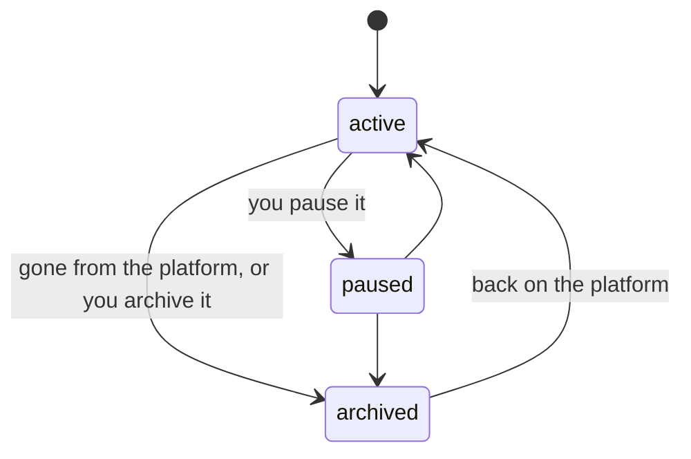

## Two kinds of program

| Origin | Created by | Scope edited by | Example |
|---|---|---|---|
| `scopesextractor` | the sync | the sync, plus local rules | a HackerOne program |
| `manual` | you | you | MSRC, a private contract |

A synced program is identified by `(platform, slug)`. A manual program has no platform identity and the
sync never touches it.

## The sync

Recon polls ScopesExtractor's `GET /` every hour (configurable; ScopesExtractor itself syncs the
platforms every three hours) and reconciles against the full state. A pass that fails changes nothing,
and the next one repairs it.

Each entry carries `platform`, `slug`, `program_name`, `bounty`, `value`, `type` and `is_in_scope`.
Recon groups entries by `(platform, slug)` into programs. A sync can also be started by hand
(`POST /api/sync`).

**A pass that would archive too much is refused.** An empty answer, or one that drops more than half of
the synced programs at once (configurable), is far more likely a ScopesExtractor problem than half the
programs closing on the same hour. The pass changes nothing and raises a health error.

A changed scope is a closed rule plus an opened one. A program is archived **by the sync** when it
leaves ScopesExtractor, and only such a program is reactivated when it comes back: one you archived or
paused yourself stays as you left it. Its rules are left open while it is archived, so it comes back
with its scope and the next pass reconciles any difference. ScopesExtractor already notifies scope changes on
Discord, so Recon does not repeat them.

### How a scope value becomes a rule

| ScopesExtractor value | Rule | Side effect |
|---|---|---|
| `*.example.com` | `apex example.com` | a [wildcard](#wildcards) |
| `api.example.com` | `fqdn api.example.com` | the host is declared as an asset (from phase 2, when assets exist) |
| `https://example.com/app/`, `https://example.com:8443/` | `url_prefix` | the URL, its service and its host are declared |
| `https://www.example.com/` | `fqdn www.example.com`: a bare root on the default port names the host | as for a host |
| `api.example.com/graphql`, `example.com:8443` | `url_prefix`, taken as `https://` | as for a URL |
| `10.0.0.0/24`, `10.0.0.1` | `cidr` (a single address is a `/32`) | none, it classifies resolved addresses |
| any value of type `mobile`, `executable`, `source_code`, `other` | not stored as a rule | listed on the program as untracked. The type decides, not the shape: most `mobile` values are store links (`play.google.com/...`) that would otherwise put the store in scope |
| any entry with `is_in_scope: false` | the same matcher, as an `exclude` rule | |

Platforms rarely expose their out of scope list through ScopesExtractor, so most exclusions are
[local rules](#local-rules).

### Local rules

A synced program can carry **local** rules, typically an exclusion or an extra host. The sync owns
only the rules it created, so it never closes a local one, and its own rules cannot be edited: the next
pass would put them back. To narrow a synced scope, add a local exclusion.

Editing a local rule closes it and opens a new one, so the history keeps both.

Every rule write, by the sync or by hand, refreshes the program in the same transaction: what an
include `fqdn` or `url_prefix` names is declared, every asset is classified again, and a wildcard
created now is queued if auto-scan says so. At startup every program is refreshed once, which catches
up on rules written while the inventory could not follow.

## Scope evaluation

Every asset is classified each time it is written, and every time a rule changes.

| Status | Stored | Probed | Typical case |
|---|---|---|---|
| `in_scope` | yes | yes | under a wildcard |
| `out_of_scope` | yes | no | excluded host |
| `unknown` | yes | no | a third party name reached through a CNAME or a SAN |

A service or a URL takes the status of its host, except that a `url_prefix` exclusion can take one path
out while its service stays in.

## Program states

A paused or archived program is never probed. Its assets keep their lifecycle: we stopped looking, the
targets did not die.

## Wildcards

Every `apex` rule is a wildcard, and a wildcard carries its own recon history.

| Column | Meaning |
|---|---|
| `last_recon_at` | end of the last discovery run on it, `NULL` if never |
| `last_recon_run` | that run |
| `assets_found` | assets whose lineage starts at this wildcard |
| `auto_scan` | inherited from the program, then the global setting |

### Auto-scan

| Setting | When a new wildcard appears |
|---|---|
| `off` | nothing, it shows up as never scanned |
| `on_new` | one discovery run is queued |

Global default in the config, overridable per program. There is no per wildcard setting: the
[wildcards view](/architecture/interface/#wildcards) shows the value in effect.

A queued recon is a `run` row in state `queued`. Runs start oldest wildcard first under a concurrency
cap ([run states](/architecture/stack/#run-states)), so a first sync bringing two hundred wildcards does
not start two hundred scans at once.
