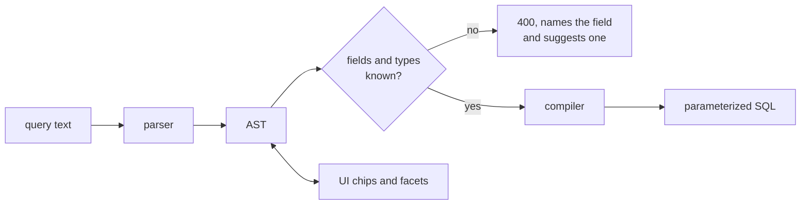

The inventory is only useful if it can be queried precisely. Search is a **text language**, in the
spirit of Shodan or GitHub search, typed in one box and editable through facets.

```
tech:nginx@<1.25 status:2xx port:8080,8443 -cdn:cloudflare
tech:wordpress@5.0..6.1 program:acme* first_seen:<7d
(status:401 OR status:403) has:favicon -triage:ignored
```

## Grammar

```
query    = or
or       = and { "OR" and }
and      = unary { unary }                 implicit AND between terms
unary    = [ "-" | "NOT " ] atom
atom     = term | "(" or ")"
term     = "has:" field                    has is a keyword, not a field
         | "tech:" literal [ "@" vrange ]
         | field ":" values
values   = value { "," value }             comma = OR inside one field
value    = [ op ] literal
         | literal ".." literal             inclusive range
         | "/" regex "/"
vrange   = "?" | vvalue { "," vvalue }      ? = no version detected
vvalue   = [ op ] version | version ".." version
op       = ">" | ">=" | "<" | "<="
literal  = word | "quoted string" | age | class
age      = number ( "m" | "h" | "d" )      7d = seven days ago
class    = digit "xx"                      status classes: 2xx, 4xx
```

## Operators

| Syntax | Meaning | Example |
|---|---|---|
| `field:value` | equals, case-insensitive | `server:nginx` |
| `field:val*` | glob | `title:*admin*` |
| `field:"a b"` | quoted value | `title:"Sign in"` |
| `field:a,b` | any of | `port:80,443` |
| `field:>n` `>=` `<` `<=` | comparison | `status:>=500` |
| `field:a..b` | inclusive range | `status:400..499` |
| `field:/re/` | regex | `host:/^dev[0-9]+\./` |
| `-term` or `NOT term` | negation | `-cdn:*` |
| `has:field` | the field has a value | `has:screenshot` |
| `a OR b`, `( )` | boolean | `(port:9200 OR port:5601)` |

Status codes also accept classes: `status:2xx`, `status:4xx,5xx`.

Dates take an absolute date or an age: `first_seen:>=2026-10-01`, `first_seen:<7d` (first seen less than
seven days ago), `last_changed:<24h`.

## Technologies and versions

`@` binds a version to its own technology, so `tech:nginx@<1.25` never matches an asset where nginx has
no version and another technology is `1.2`.

A partial version stands for **every version it is a prefix of**: `1.24` means `1.24`, `1.24.0`,
`1.24.3`… In other words `1.24` is the interval from `1.24` up to, not including, `1.25`, and each
operator compares against one end of it:

| Written | Read as |
|---|---|
| `@1.24` | `≥ 1.24` and `< 1.25` |
| `@<1.25` | `< 1.25` |
| `@<=1.24` | `< 1.25` |
| `@>1.24` | `≥ 1.25` |
| `@>=1.24` | `≥ 1.24` |
| `@5.0..6.1` | `≥ 5.0` and `< 6.2` |

| Constraint | Matches | Does not match |
|---|---|---|
| `tech:nginx` | any nginx | |
| `tech:nginx@1.24` | 1.24, 1.24.0, 1.24.3 | 1.25.0, 1.2 |
| `tech:nginx@1.24.0` | 1.24.0 | 1.24, 1.24.1 |
| `tech:nginx@<1.25` | 1.24.9, 1.9 | 1.25, 1.25.1 |
| `tech:nginx@<=1.24` | 1.24.9 | 1.25.0 |
| `tech:nginx@>1.24` | 1.25.0, 2.0 | 1.24.9 |
| `tech:nginx@>=1.24` | 1.24.0, 1.30 | 1.23.9 |
| `tech:wordpress@5.0..6.1` | 5.0 to 6.1.x | 6.2 |
| `tech:php@7,8.0` | 7.x or 8.0.x | 8.1 |
| `tech:jquery@?` | jQuery with no detected version | |
| `category:"Web servers"` | any technology in that category | |

Comparison runs on the [parsed version](/architecture/fingerprinting/#technologies), an integer array.
A technology with no parsable version matches only a bare `tech:name` or `@?`.

## Fields

| Field | Type | Example |
|---|---|---|
| `host` | text | `host:api.*` |
| `apex` | domain, label boundary | `apex:target.com` matches `a.target.com`, never `target.com.evil.com` |
| `program`, `platform` | text | `platform:hackerone` |
| `kind` | `fqdn`, `ip`, `service`, `url` | `kind:service` |
| `scope` | `in`, `out`, `unknown` (short for `in_scope`, `out_of_scope`, `unknown`) | `scope:unknown` |
| `state` | lifecycle | `state:active,flapping` |
| `port`, `scheme` | number, text | `port:2375 scheme:http` |
| `ip`, `asn`, `asn_org`, `country` | IP or CIDR, number, text | `ip:10.0.0.0/8` |
| `cname` | any name in the CNAME chain | `cname:*.azurewebsites.net` |
| `cdn` | vendor from FastRecon, `*` for any | `cdn:cloudflare` |
| `waf` | WAF technology from the Fingerprinter | `waf:*` |
| `status` | number or class | `status:3xx` |
| `title`, `server`, `final_url` | text | `final_url:*/login*` |
| `redirect` | any host in the redirect chain | `redirect:*.okta.com` |
| `tech`, `category` | technology and version | see above |
| `header` / `header.<name>` | header present / header value | `header.x-powered-by:PHP*` |
| `cookie`, `script`, `favicon`, `external` | pivot values | `favicon:-1293034` |
| `websocket` | WebSocket URL opened by the page | `websocket:wss://*` |
| `has:` | `screenshot`, `favicon`, `robots`, `sitemap`, `llms_txt`, `tech`, `websocket`, `note` | `has:llms_txt` |
| `source` | discovery source | `source:certstream` |
| `first_seen`, `last_seen`, `last_changed` | date or age | `first_seen:<24h` |
| `triage`, `tag` | your own state | `triage:new tag:todo` |

The served list (`GET /api/search/fields`) is authoritative, and the UI autocompletes from it.

## From text to SQL



- **The AST is the query.** Facets and chips edit the AST and print it back as text, so the box and the
  UI never disagree.
- **Every value is a bind parameter.** No string concatenation reaches SQL.
- **An unknown field is an error, not an empty result.** An empty page reads as an empty inventory.
- **A negation keeps what has no value.** `-cdn:*` matches every asset with no CDN: each term is false,
  never unknown, when its column is empty, so `NOT` cannot drop rows silently.
- **An age is "less than this long ago".** `first_seen:<7d` is first seen in the last seven days,
  `first_seen:>7d` before that.

## Results

| View | Rows | Use |
|---|---|---|
| Services | one row per service or declared URL, with screenshot, status, title, technologies | the default |
| Hosts | one row per host that matches or has a matching service, its matching services folded in | triage by name |
| Assets | every kind, nothing folded | names, addresses, candidates |

A query naming `kind:` is not narrowed by the view. Results are newest first (`first_seen`), paged
with an opaque cursor tied to the view, so a cursor from one view is refused by another.

### Facets

Counts over the current result, one click adds the term: technologies, status classes, ports,
programs, CDN, lifecycle, triage. A facet value that would add a term already in the query toggles it.

### Pivots

A **pivot** is a value that links assets nothing else connects: a favicon hash, an internal script
hash, a cookie name. Each asset view shows, per pivot, how many other assets share it, and clicking it
runs the search. A value found everywhere (a CDN script, `PHPSESSID`) is hidden as generic: shared by
assets of five programs or more, or shared by no other asset at all.

### Export

Any result exports as CSV, JSON, or a plain list of URLs or hosts, ready to pipe into another tool, up to
100 000 rows.

## Saved searches

A query can be saved with a name. A saved search can **alert**: when an asset enters its result set,
you get one notification for the batch. This is how you ask for any alert beyond the built-in
essentials, see [notifications](/architecture/notifications/#saved-search-alerts).

| Example | Query |
|---|---|
| Exposed Docker or Kubernetes | `port:2375,2376,6443,10250 -state:inactive,archived` |
| Old Jenkins | `tech:jenkins@<2.440` |
| New login pages | `title:*login*,"*sign in*" first_seen:<24h` |
| Open databases | `port:3306,5432,27017,6379,9200 -state:inactive,archived` |

A port that speaks no HTTP leaves its service a `candidate` ([lifecycle](/architecture/lifecycle/#state-machine)),
so these examples exclude the dead rather than asking for `active`.
