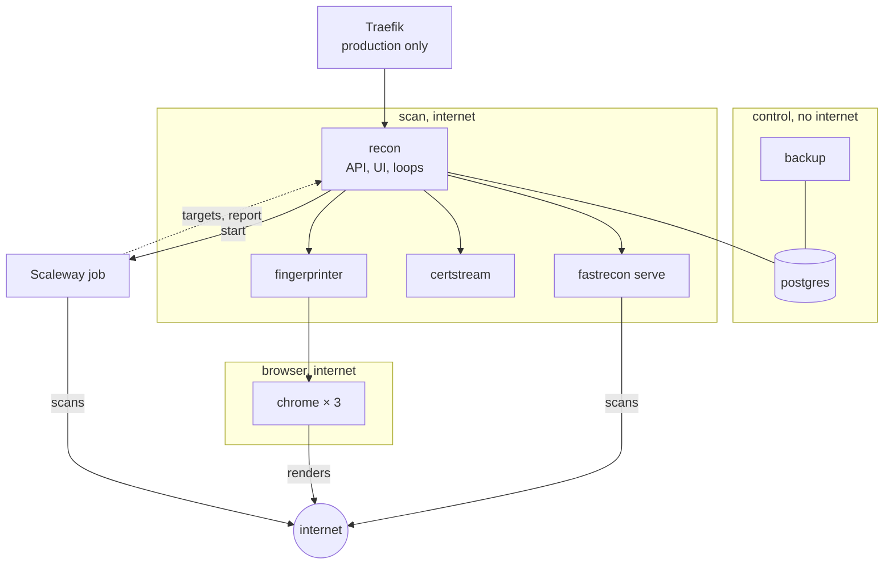
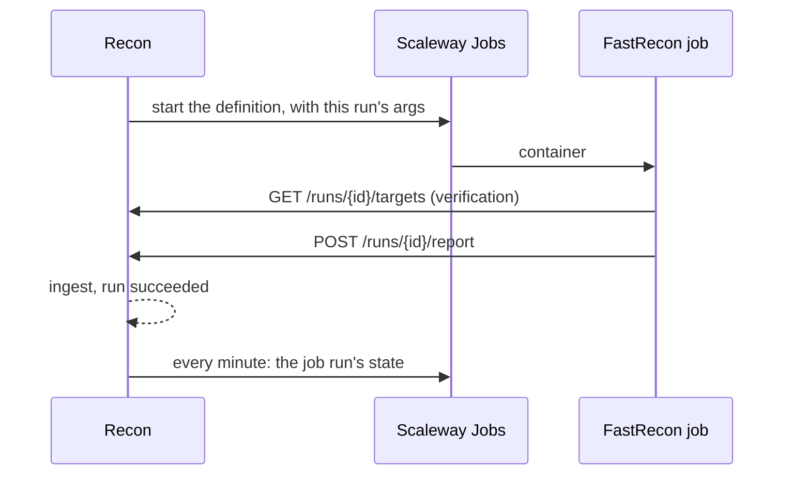
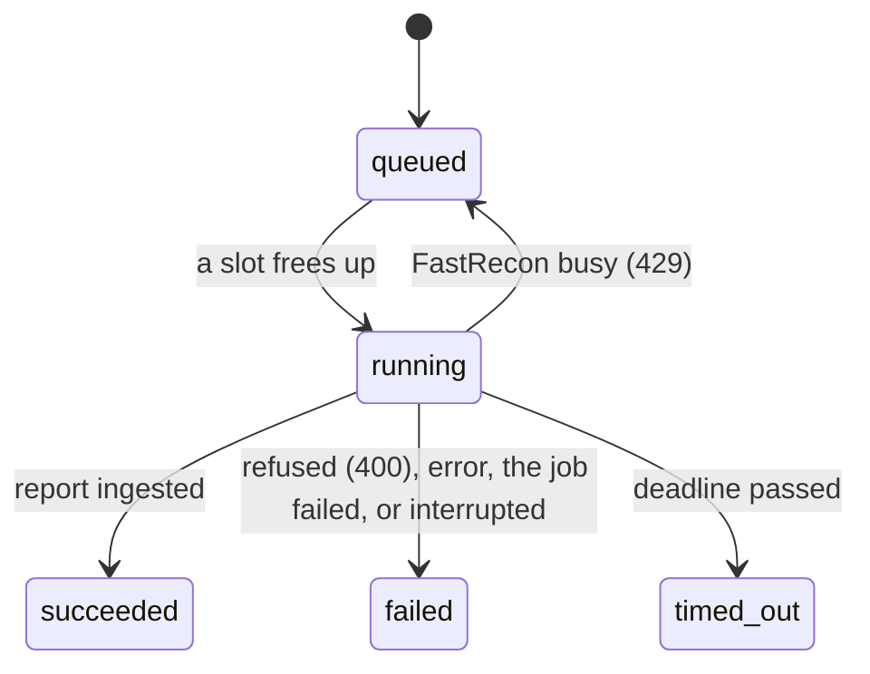

## Choices

| Role | Choice | Why |
|---|---|---|
| Backend | **Go**, one binary | same language as FastRecon and the Fingerprinter, a static binary to deploy |
| UI | **SvelteKit, static adapter**, embedded with `embed.FS` | no Node process in production, the binary serves it |
| Database | **PostgreSQL 18** | `jsonb`, arrays, `inet`, partitions: the search language compiles to them |
| Data access | **sqlc** + **pgx/v5** | hand written SQL, generated types |
| Migrations | **goose** | SQL files, embedded, run at startup |
| Config | **koanf**: defaults, then YAML, then `RECON_*` env | one typed struct, validated at startup |
| IP enrichment | a local MMDB file (ASN and country), refreshed monthly | no API call per address |
| CT feed | `certstream-server-go` image | the matcher is a loop inside Recon |

Not used: an ORM, a message broker, Kubernetes.

## Config file or UI

| In the config file | In the UI (database) |
|---|---|
| `public_url`, API key, database URL | programs, manual programs, local rules |
| ScopesExtractor URL and key, sync interval | auto-scan per program |
| Fingerprinter URL, render concurrency | triage, tags, notes |
| runner choice and credentials (FastRecon source keys live in the job) | saved searches and their alerts |
| port list, cadences, backoff curves, batch size | |
| auto-scan global default | |
| notification channels | |
| screenshot backend, quality, cap, disk threshold | |
| dead-origin signatures | |

The settings screen shows the config values read-only, so you can check what is in effect.

## Deployment



Recon is the only service on both sides. The database network has no internet access and holds only
PostgreSQL, Recon and the backup. Chrome, the one process running code a target wrote, shares its
network with the Fingerprinter alone, so it reaches neither Recon nor the database. `make
verify-isolation` checks these properties on the running stack, each next to a probe that must succeed.

| | `compose.yaml`, local | `compose.prod.yaml`, the VPS |
|---|---|---|
| Entry | ports on 127.0.0.1 | none: Traefik on its own network, `RECON_HOST` gives the route and `https://` the public URL |
| Backups | `var/backups` in the checkout | `BACKUP_DIR`, an absolute path outside the checkout a redeploy replaces |
| Render concurrency | 20 | 10 (`RENDER_CONCURRENCY`): a VPS shared with other services drops captures at 20 |
| certstream | unbounded | `cpus: 4` (`CERTSTREAM_CPUS`) and `cpu_shares: 256`: it takes 8 to 12 cores when free to, and yields to the rest under contention |
| Logs | Chrome's discarded | capped everywhere |

The Fingerprinter restarts with the browsers (`depends_on` with `restart: true`): its connections to a
recreated Chrome are dead, and its reconnects would close the new one in a loop.

## Runs

A FastRecon run is started by a **runner**, behind one interface:

| Runner | Where FastRecon runs | How the report comes back | Takes |
|---|---|---|---|
| `serve` | `fastrecon serve`, a service of the compose stack | as the response to `POST /run`, synchronously | CT candidates always; recon and verification without a remote runner |
| `scaleway` | a Scaleway Serverless Job, scanning from other addresses than the VPS | posted to `/runs/{id}/report` | recon and verification, when `runner.provider` is `scaleway` |

CT candidates stay on `serve`: a job takes tens of seconds to start, for a run of seconds whose worth is
minutes. `serve` needs no credential on Recon's side beyond the FastRecon token. One instance runs one
run at a time and answers `429` otherwise, so the number of instances is the number of slots.

### The run contract

```json
{"domain": "example.com", "exclude": ["*.dev.example.com", "admin.example.com"],
 "stages": "full", "ports": "80,443,8080,...", "timeout": "30m"}

{"targets": ["api.example.com", "www.example.com"], "stages": "resolve",
 "ports": "80,443,8080,...", "timeout": "30m"}
```

- The first shape is a recon on a wildcard, the second a verification or a CT candidate run.
- `run.stage` holds the value sent as `stages`: `enum`, `resolve`, `ports` or `full`.
- The exclusions are the program's `exclude` rules that name hosts: an `fqdn` as is, an `apex` as both
  the apex and `*.apex`. `url_prefix` and `cidr` exclusions are applied at ingestion.
- The report is re-derived on arrival: a recon's hosts must sit under its wildcard, a verification's
  must be its targets, and every outcome is recomputed.
- FastRecon's source API keys live in its own environment, never in a request.

### The Scaleway runner



| Rule | Why |
|---|---|
| Recon starts the definition, it never updates it | an update replaces the whole environment and wipes the source keys without an error |
| the whole invocation travels as arguments: `--stages`, `-d` or `--targets-url`, `--exclude`, `--ports`, `--timeout`, `--webhook-url`, `--webhook-timeout`, and the tokens as headers | arguments replace the definition's, the environment merges with it: a `-d` left on the definition must never pin a run |
| two HMAC tokens over `(run, purpose, expiry)`, one to fetch the targets, one to post the report, in headers | nothing is stored or revoked; a token in a URL lands in every access log |
| the report token lasts the deadline plus a grace | a run that spends its whole budget can still deliver |
| `--webhook-timeout` is minutes, not the 30 s default | ingesting a large report takes longer, and a hang-up rolled back the write while retries redid the work |
| a report for a run that is not running answers `409` and is not ingested | FastRecon retries a delivery; the second copy of an ingested report changes nothing |
| at startup, the definition is read: it must exist, retry nothing, and outlive `fastrecon.timeout` | a misconfiguration is a log line at boot, not a first run that dies |
| every minute, the job run's state is read | a job the platform calls failed closes its run at once, with the platform's reason, instead of at its deadline |
| a run past its deadline is timed out and its job stopped | a job does not outlive the run it belongs to |
| `runner.callback_url` is where a job reaches Recon, `public_url` by default | a local test exposes Recon through a tunnel while the interface stays on `localhost` |
| the callback is `https`, `http` only to localhost | the run tokens travel with every call |
| the job routes are always served, and jobs are followed whenever the Scaleway settings are set | a job started before a switch back to `serve` still delivers, and is still watched and stopped |
| a report is taken with its run locked | a delivery retried while the first copy is still being written is answered `409` at once |
| a job whose id could not be recorded is stopped and its run failed | unrecorded, it could be neither watched nor stopped |

### Run states



| Rule | Value |
|---|---|
| deadline | the run's `timeout` plus 10 minutes |
| a sweeper | marks `running` runs past their deadline `timed_out`, every minute |
| at startup | runs left `running` on `serve` are `failed`: a synchronous call does not survive its caller. A job keeps running and is still waited for |
| a report after a terminal state | not ingested |
| a timed out verification | its hosts are still due, the next tick takes them again |
| a failed or timed out recon | `wildcard.last_recon_at` does not move |

### Concurrency

A slot is a run in `running`, counted per runner.

| Kind | Slots (config) | Order |
|---|---|---|
| recon | `fastrecon.slots` on `serve`, `runner.slots` on Scaleway | queue order, and `scan the N oldest` queues oldest first |
| verification | 1 at a time, on the same runner as recon | due date |
| CT candidates | 1, on `serve`, ahead of the queue | so a candidate never waits behind a batch; runs with verification off |
| renders | adaptive, see [absorbing a burst](/architecture/fingerprinting/#absorbing-a-burst) | priority, then due date |

## Backups

The `backup` service runs `deploy/compose/backup.sh`: a `pg_dump` every night into `var/backups`, pruned
after a retention. Pushing dumps to the screenshot bucket comes with the S3 backend.

| Command | Does |
|---|---|
| `make backup` | a dump now |
| `make restore-check` | restores the latest dump into a scratch database, checks it, drops it |
| `make restore FILE=…` | restores a dump over the live database, with recon stopped |

The integration suite runs the same script against the same image, including a restore over damaged
data and a refusal of a file that is not a dump.

## Repository

```
cmd/recon/            the binary: serve, migrate, healthcheck, version, later import bbot
internal/
  version/            the build version, set at link time
  config/             the only reader of the environment
  canon/              canonical names, URLs and networks
  store/              pool, migrations, sqlc queries, storetest for integration tests
  scope/              rule matching, ScopesExtractor sync
  normalize/          the single normalize(layer, data)
  inventory/          assets, deduplicated observations, changes, declared assets, refresh
  ingest/             FastRecon reports: parse, normalize, qualify, write
  lifecycle/          the state machine and the backoff curves, pure functions
  runs/               queue, scheduler, runners, sweeper
  ct/                 matcher
  fingerprint/        Fingerprinter client, render normalization, versions, screenshots, storage
  render/             dispatcher (pacing, politeness), render ingestion
  search/             parser, AST printed back, field registry, compiler, views, facets, export
  enrich/             GeoLite2 lookups: ASN, AS organization, country
  notify/             evaluator, windows, channels
  bbot/               import parser
  api/                HTTP handlers
  ui/                 serves the embedded build: index.html for the paths it routes, a hashed CSP
db/embed.go           embeds the migrations
db/migrations/        goose
db/queries/           SQL for sqlc
web/                  SvelteKit, built into internal/ui/dist by make ui and by the image
docs/                 this site
deploy/compose/       the stack, Dockerfile, backup and isolation scripts
config.example.yml    every setting with its default, checked against the code by a test
```
