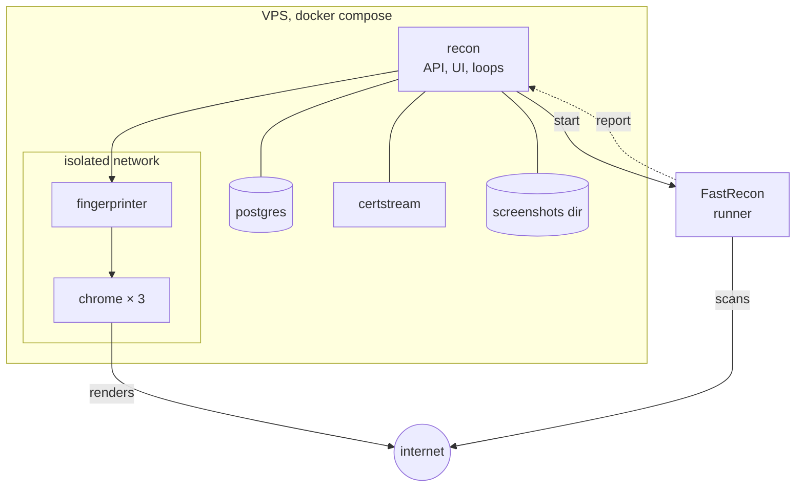
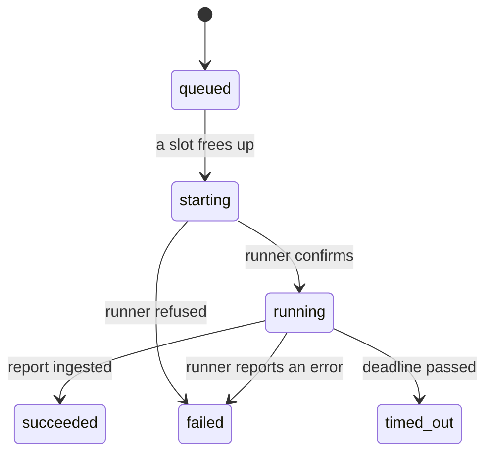

## Choices

| Role | Choice | Why |
|---|---|---|
| Backend | **Go**, one binary | same language as FastRecon and the Fingerprinter, a static binary to deploy |
| UI | **SvelteKit, static adapter**, embedded with `embed.FS` | no Node process in production, the binary serves it |
| Database | **PostgreSQL 18** | `jsonb`, arrays, `inet`, partitions: the search language compiles to them |
| Data access | **sqlc** + **pgx/v5** | hand written SQL, generated types |
| Migrations | **goose** | SQL files, embedded, run at startup |
| Config | **koanf**: defaults, then YAML, then `RECON_*` env | one typed struct, validated at startup |
| IP enrichment | a local MMDB file (ASN and country), refreshed monthly | no API call per address |
| CT feed | `certstream-server-go` image | the matcher is a loop inside Recon |

Not used: an ORM, a message broker, Kubernetes.

## Config file or UI

| In the config file | In the UI (database) |
|---|---|
| `public_url`, API key, database URL | programs, manual programs, local rules |
| ScopesExtractor URL and key, sync interval | auto-scan per program |
| Fingerprinter URL, render concurrency | triage, tags, notes |
| runner choice and credentials, FastRecon source keys | saved searches and their alerts |
| port list, cadences, backoff curves, batch size | |
| auto-scan global default | |
| notification channels | |
| screenshot backend, quality, cap, disk threshold | |
| dead-origin signatures | |

The settings screen shows the config values read-only, so you can check what is in effect.

## Deployment



The Fingerprinter and Chrome sit on a network with internet access and no route to PostgreSQL. Recon
calls them, they never call back.

## Runs

A FastRecon run is started by a **runner**, behind one interface (`start`, `status`):

| Runner | Where FastRecon runs | Reaches Recon through |
|---|---|---|
| `docker` | a container on the VPS | the compose network |
| `scaleway` | a Scaleway Serverless Job, to scan from other addresses than the VPS | `public_url`, which must then be reachable from the internet over HTTPS |

### The run contract

```
--stages full | resolve
--domain example.com --exclude '*.dev.example.com'      (recon)
--targets-url {public_url}/runs/{id}/targets            (verification)
--targets-header "Authorization: Bearer <targets token>"
--ports 80,443,8080,...
--scan-rate 10
--webhook-url {public_url}/runs/{id}/report
--webhook-header "Authorization: Bearer <report token>"
--timeout 30m
```

- `run.stage` holds the value passed to `--stages`: `enum`, `resolve`, `ports` or `full`.
- Both tokens are HMACs over `(run id, purpose, expiry)`: nothing to store, they expire on their own.
- No token travels in a URL.
- The report is re-derived on arrival: its hosts must be the run's targets (or under its wildcard), and
  every outcome is recomputed.
- FastRecon's source API keys live in the runner's environment, never in the definition.

### Run states



| Rule | Value |
|---|---|
| deadline | `--timeout` plus 10 minutes |
| a sweeper | marks `starting` or `running` runs past their deadline `timed_out`, every minute |
| a report after a terminal state | refused with `409` |
| a timed out verification | its hosts are still due, the next tick takes them again |
| a failed or timed out recon | `wildcard.last_recon_at` does not move |

### Concurrency

A slot is a run in `starting` or `running`.

| Kind | Slots (config) | Order |
|---|---|---|
| recon | 2 | oldest `last_recon_at` first, never scanned on top |
| verification | 1 | due date |
| CT candidates | 1, separate | so a candidate never waits behind a batch |
| renders | adaptive, see [absorbing a burst](/architecture/fingerprinting/#absorbing-a-burst) | priority, then due date |

## Backups

A nightly `pg_dump` to the disk, with a retention, and optionally pushed to the same S3 bucket as the
screenshots. A restore is tested once in phase 0.

## Repository

```
cmd/recon/            the binary: serve, migrate, import bbot <program> <file>
internal/
  config/             the only reader of the environment
  store/              sqlc queries
  scope/              rule matching, ScopesExtractor sync
  normalize/          the single normalize(layer, data)
  ingest/             reports, observations, changes
  lifecycle/          qualification, transitions, backoff
  runs/               definitions, tokens, runners, sweeper
  ct/                 matcher
  render/             dispatcher, Fingerprinter client, screenshots
  search/             parser, AST, compiler, facets
  notify/             evaluator, windows, channels
  bbot/               import parser
  api/                HTTP handlers
db/migrations/        goose
db/queries/           SQL for sqlc
web/                  SvelteKit, built into internal/ui
docs/                 this site
deploy/compose/       the stack
```
