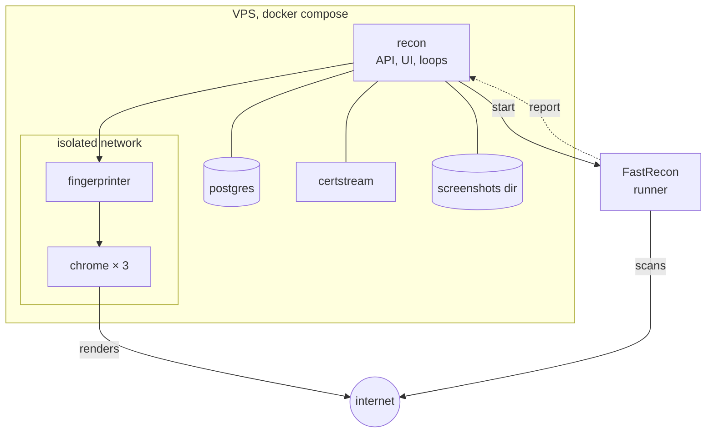
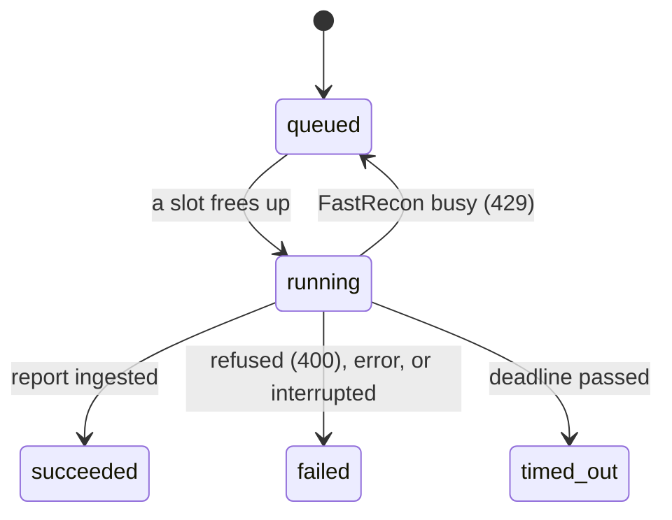

## Choices

| Role | Choice | Why |
|---|---|---|
| Backend | **Go**, one binary | same language as FastRecon and the Fingerprinter, a static binary to deploy |
| UI | **SvelteKit, static adapter**, embedded with `embed.FS` | no Node process in production, the binary serves it |
| Database | **PostgreSQL 18** | `jsonb`, arrays, `inet`, partitions: the search language compiles to them |
| Data access | **sqlc** + **pgx/v5** | hand written SQL, generated types |
| Migrations | **goose** | SQL files, embedded, run at startup |
| Config | **koanf**: defaults, then YAML, then `RECON_*` env | one typed struct, validated at startup |
| IP enrichment | a local MMDB file (ASN and country), refreshed monthly | no API call per address |
| CT feed | `certstream-server-go` image | the matcher is a loop inside Recon |

Not used: an ORM, a message broker, Kubernetes.

## Config file or UI

| In the config file | In the UI (database) |
|---|---|
| `public_url`, API key, database URL | programs, manual programs, local rules |
| ScopesExtractor URL and key, sync interval | auto-scan per program |
| Fingerprinter URL, render concurrency | triage, tags, notes |
| runner choice and credentials, FastRecon source keys | saved searches and their alerts |
| port list, cadences, backoff curves, batch size | |
| auto-scan global default | |
| notification channels | |
| screenshot backend, quality, cap, disk threshold | |
| dead-origin signatures | |

The settings screen shows the config values read-only, so you can check what is in effect.

## Deployment



The Fingerprinter and Chrome sit on a network with internet access and no route to PostgreSQL, and the
database network has no internet access. Recon calls them, they never call back. `make verify-isolation`
checks both properties on the running stack, each next to a probe that must succeed.

## Runs

A FastRecon run is started by a **runner**, behind one interface:

| Runner | Where FastRecon runs | How the report comes back |
|---|---|---|
| `serve` | `fastrecon serve`, a service of the compose stack | as the response to `POST /run`, synchronously |
| `scaleway` (later) | a Scaleway Serverless Job, to scan from other addresses than the VPS | webhook to `public_url`, which must then be reachable over HTTPS |

`serve` is the default and needs no credential on Recon's side beyond the FastRecon token: no Docker
socket, no webhook, no target URL. One `fastrecon serve` instance runs one run at a time and answers
`429` otherwise, so the number of instances is the number of slots.

### The run contract

```json
{"domain": "example.com", "exclude": ["*.dev.example.com", "admin.example.com"],
 "stages": "full", "ports": "80,443,8080,...", "timeout": "30m"}

{"targets": ["api.example.com", "www.example.com"], "stages": "resolve",
 "ports": "80,443,8080,...", "timeout": "30m"}
```

- The first shape is a recon on a wildcard, the second a verification (phase 3).
- `run.stage` holds the value sent as `stages`: `enum`, `resolve`, `ports` or `full`.
- The exclusions are the program's `exclude` rules that name hosts: an `fqdn` as is, an `apex` as both
  the apex and `*.apex`. `url_prefix` and `cidr` exclusions are applied at ingestion.
- The report is re-derived on arrival: a recon's hosts must sit under its wildcard, a verification's
  must be its targets, and every outcome is recomputed.
- FastRecon's source API keys live in its own environment, never in a request.
- The `scaleway` runner adds two HMAC tokens over `(run id, purpose, expiry)` for its target URL and
  webhook, so nothing is stored and they expire on their own.

### Run states



| Rule | Value |
|---|---|
| deadline | the run's `timeout` plus 10 minutes |
| a sweeper | marks `running` runs past their deadline `timed_out`, every minute |
| at startup | runs left `running` by a stopped process are `failed`: a synchronous call does not survive it |
| a report after a terminal state | not ingested |
| a timed out verification | its hosts are still due, the next tick takes them again |
| a failed or timed out recon | `wildcard.last_recon_at` does not move |

### Concurrency

A slot is a run in `running`.

| Kind | Slots (config) | Order |
|---|---|---|
| recon | 1 per `fastrecon serve` instance | queue order, and `scan the N oldest` queues oldest first |
| verification | 1 | due date |
| CT candidates | 1, separate | so a candidate never waits behind a batch |
| renders | adaptive, see [absorbing a burst](/architecture/fingerprinting/#absorbing-a-burst) | priority, then due date |

## Backups

The `backup` service runs `deploy/compose/backup.sh`: a `pg_dump` every night into `var/backups`, pruned
after a retention. Pushing dumps to the screenshot bucket comes with the S3 backend.

| Command | Does |
|---|---|
| `make backup` | a dump now |
| `make restore-check` | restores the latest dump into a scratch database, checks it, drops it |
| `make restore FILE=…` | restores a dump over the live database, with recon stopped |

The integration suite runs the same script against the same image, including a restore over damaged
data and a refusal of a file that is not a dump.

## Repository

```
cmd/recon/            the binary: serve, migrate, healthcheck, version, later import bbot
internal/
  version/            the build version, set at link time
  config/             the only reader of the environment
  canon/              canonical names, URLs and networks
  store/              pool, migrations, sqlc queries, storetest for integration tests
  scope/              rule matching, ScopesExtractor sync
  normalize/          the single normalize(layer, data)
  inventory/          assets, deduplicated observations, changes, declared assets, refresh
  ingest/             FastRecon reports: parse, normalize, qualify, write
  lifecycle/          the state machine and the backoff curves, pure functions
  runs/               queue, scheduler, runners, sweeper
  ct/                 matcher
  fingerprint/        Fingerprinter client, render normalization, versions, screenshots, storage
  render/             dispatcher (pacing, politeness), render ingestion
  search/             parser, AST, compiler, facets
  notify/             evaluator, windows, channels
  bbot/               import parser
  api/                HTTP handlers
db/embed.go           embeds the migrations
db/migrations/        goose
db/queries/           SQL for sqlc
web/                  SvelteKit, built into internal/ui
docs/                 this site
deploy/compose/       the stack, Dockerfile, backup and isolation scripts
config.example.yml    every setting with its default, checked against the code by a test
```
